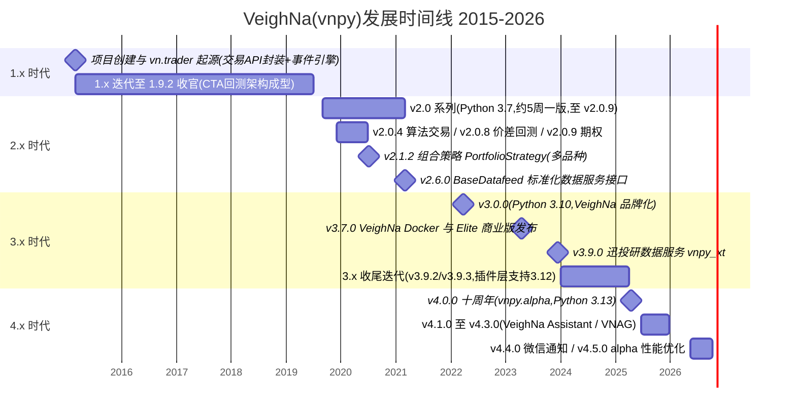
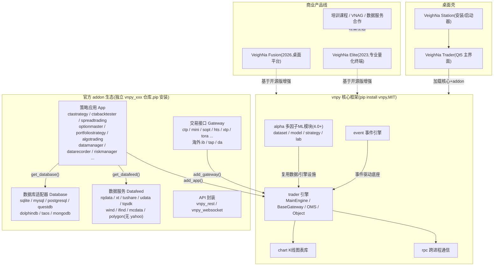

# vnpy(VeighNa)开源量化交易平台深度研究报告

- **研究日期:** 2026-10-20
- **时间戳:** 2026-10-20 11:16 +08:00
- **置信度水平:** 高(核心结论均经「Web 多源交叉 + 源码直读」双轨验证;低置信项已在第十一章单列)
- **研究对象:** [vnpy/vnpy](https://github.com/vnpy/vnpy)及其 CTA 回测子生态(vnpy_ctastrategy),聚焦「无 GUI 日频 K 线回测服务」场景

---

## 一、仓库信息(Repository Information)

- **名称:** vnpy(品牌名 VeighNa)
- **描述:** 基于 Python 的开源量化交易平台开发框架,口号「By Traders, For Traders, AI-Powered」[citation:vnpy/vnpy - GitHub](https://github.com/vnpy/vnpy)、[citation:vnpy · PyPI](https://pypi.org/project/vnpy/)
- **URL:** https://github.com/vnpy/vnpy
- **Stars:** 45,951(2026-10 抓取,约 46.0k)[citation:vnpy/vnpy - GitHub](https://github.com/vnpy/vnpy)
- **Forks:** 约 12.5k(2026-10)[citation:vnpy/vnpy - GitHub](https://github.com/vnpy/vnpy)
- **语言:** Python(核心),含 C++ API 封装的 gateway addon
- **License:** MIT
- **创建时间:** 2015-03
- **最新 Release:** 4.5.0(PyPI 2026-10-06,官方公告 2026-10-13)[citation:vnpy · PyPI](https://pypi.org/project/vnpy/)、[citation:VeighNa发布v4.5.0 - 多因子策略模块性能优化 - VeighNa量化社区](https://www.vnpy.com/forum/post/70728)
- **配套对象:** vnpy_ctastrategy 1.5.0(CTA 策略应用模块)[citation:vnpy/vnpy_ctastrategy - GitHub](https://github.com/vnpy/vnpy_ctastrategy)、[citation:vnpy-ctastrategy · PyPI](https://pypi.org/project/vnpy-ctastrategy/)
- **代码尽调基线:** vnpy tag 4.5.0(commit c6e231c)、vnpy_ctastrategy tag 1.5.0(commit 7a8768d),均为 master 深克隆快照(本地路径 `/tmp/vnpy-research/`)

---

## 二、执行摘要(Executive Summary)

vnpy(VeighNa)是 2015-03 创建、源自国内私募自研交易系统的全栈开源量化交易平台,现以 45,951 stars、MIT 协议、约 12.5k forks 的体量构成国内量化领域事实上的主流社区之一,最新 release 4.5.0 于 2026-10-06 发布并重写了 vnpy_alpha 六个时序算子,4.x 系列在约 18 个月内迭代 6 个 minor 版本,2026 年官方主题为「全面拥抱 Agentic AI」[citation:vnpy/vnpy - GitHub](https://github.com/vnpy/vnpy)、[citation:VeighNa发布v4.5.0 - 多因子策略模块性能优化 - VeighNa量化社区](https://www.vnpy.com/forum/post/70728)、[citation:2026年VeighNa项目计划 - VeighNa量化社区](https://www.vnpy.com/forum/post/69895)。

代码级尽调(vnpy 4.5.0 / vnpy_ctastrategy 1.5.0)证实:回测内核 `BacktestingEngine` 完全自包含——import 面不含 `vnpy.event`/`vnpy.trader.engine`/gateway,GUI 全部隔离在 `ui/` 目录,官方 `evaluate()` 六步序列即可程序化产出 28 个统计键,4.x 的 `Interval.DAILY`/`WEEKLY` 已使日 K 成为一等公民,撮合遵循「今日收盘信号→次日开盘价成交」的日频标准假设,无需任何改造。

最高风险集中在数据通道与工程细节:官方 datafeed 清单没有 Yahoo/yfinance 适配器,需自建约 40 行抓取链路;而 yfinance 存在 `auto_adjust` 默认值静默变更、时区偏移、限流封禁等已证实坑,叠加 vnpy「数据字段/时区不对时回测静默失败」的特性,构成对日频美股回测服务最需要优先防御的失效路径 [citation:vnpy 回测引擎 DataFeed 与 BarData 结构实践 - 掘金](https://juejin.cn/post/7638584180326514722)、[citation:Why Adj Close Disappeared in yfinance (And How to Adapt) - Medium](https://medium.com/@josue.monte/why-adj-close-disappeared-in-yfinance-and-how-to-adapt-6baebf1939f6)。

**关键数字一览:**

| 数字 | 含义 |
|---|---|
| 45,951 / ~12.5k | stars / forks(2026-10) |
| 2015-03 / 4.5.0 | 仓库创建 / 最新版本(2026-10-06) |
| 6 个 minor | 4.x 系列约 18 个月内的版本数(4.0.0—4.5.0) |
| 3.10—3.13 | 官方支持的 Python 区间(`requires-python = ">=3.10"`) |
| 28 | `calculate_statistics()` 返回的统计键总数 |
| 6 步 | 无 GUI 回测的官方标准调用序列(`evaluate()`) |
| 8 + 7 | 官方文档数据服务适配器数 / 数据库适配器数 |
| 0 | 官方/社区可复用的 vnpy_yahoo(yfinance)datafeed 包数量 |
| 9 / ~42 | 自带示例策略数 / ArrayManager 内置指标方法数(基于 talib) |
| 1,294 / 507 行 | BacktestingEngine / CtaTemplate 源码行数(1.5.0 基线) |

---

## 三、发展时间线(Complete Chronological Timeline)

### 阶段一:1.x 时代(2015—2019)——交易 API 封装与 CTA 架构成型

【事实】项目起源于国内私募的自主交易系统,2015 年启动时只是交易 API 接口的 Python 封装,早期围绕事件驱动引擎(EventEngine)构建了 vn.trader 平台,整合国内交易接口与 Interactive Brokers 的 IbPy 三方接口,1.x 收官版本为 1.9.2;官方自述「v1.0 内版本的升级迭代是一步步摸着石头过河」[citation:VNPY - 百度百科](https://baike.baidu.com/item/VNPY/59208203)、[citation:如何评价 VNPY 量化回测? - BetterBench 的回答 - 知乎](https://www.zhihu.com/question/485765357/answer/2839744534)、[citation:vnpy/vnpy - GitHub](https://github.com/vnpy/vnpy)。

### 阶段二:2.x 时代(2019—2021)——快速迭代与数据层标准化

【事实】2019 年工作重心转向基于 Python 3.7 的 v2.0,约 5 周一版、一年完成 v2.0.0—v2.0.9 共 10 个版本(v2.0.4 算法交易、v2.0.8 价差回测、v2.0.9 期权);v2.1.2(2020)引入多标的组合策略模块 PortfolioStrategy;v2.6.0(2021)新增标准化数据服务接口 BaseDatafeed 与高性能金融数据库,数据服务与数据库适配器自此体系化 [citation:2020年vn.py项目计划 - VeighNa量化社区](https://www.vnpy.com/forum/)、[citation:vn.py v2.1.2 - 多标的组合策略 - VeighNa量化社区](https://www.vnpy.com/forum/topic/3111-vn-py-v2-1-2-duo-biao-de-zu-he-ce-lue)、[citation:vn.py v2.6.0 发布说明 - VeighNa量化社区](https://www.vnpy.com/forum/topic/7705-vn-pyfa-bu-v2-6-0-gao-xing-neng-jin-rong-shu-ju-ku)。

### 阶段三:3.x 时代(2022—2025)——品牌化、Docker 与数据生态扩张

【事实】v3.0.0(2022-03-23)核心支持 Python 3.10,同期品牌从 vn.py 升级为 VeighNa;v3.7.0(2023-04)推出 VeighNa Docker,同期(2023-04)发布商业版 VeighNa Elite;v3.9.0(2023-12-14)新增迅投研数据服务 vnpy_xt;2024 全年继续 3.x 尾期迭代,插件层(vnpy_tap/vnpy_tts)经 pybind11 升级支持 Python 3.12 编译 [citation:VeighNa发布v3.0.0 - VeighNa量化社区](https://www.vnpy.com/forum/post/53798)、[citation:VeighNa Elite - 面向专业交易员的量化终端 - VeighNa量化社区](https://www.vnpy.com/forum/topic/31762-veighna-elite-mian-xiang-zhuan-ye-jiao-yi-yuan-de-liang-hua-zhong-duan)、[citation:VeighNa发布v3.9.0 - 迅投研数据服务 - VeighNa量化社区](https://www.vnpy.com/forum/topic/32488-veighnafa-bu-v3-9-0-xun-tou-yan-shu-ju-fu-wu)、[citation:2024年VeighNa项目计划 - VeighNa量化社区](https://www.vnpy.com/forum/post/62892)。

### 阶段四:4.x 时代(2025-04 至今)——AI 量化与 Agentic AI

【事实】v4.0.0(PyPI 2025-04-10,官方公告口径 2025-04-15)逢项目十周年,新增受微软 Qlib 启发的 vnpy.alpha 多因子 ML 模块(dataset/model/strategy/lab),框架核心支持版本升至 Python 3.13,工程化统一为 pyproject.toml + loguru + mypy + ruff;v4.1.0(2025-06-17)、v4.2.0(2025-11-01)、v4.3.0(2025-12-24,集成 VeighNa Assistant)、v4.4.0(2026-05-14,微信通知)、v4.5.0(2026-10-06,重写六个时序算子并重构因子绩效分析);2026 年官方计划明确「全面拥抱 Agentic AI」与「降低上手门槛」两条主线 [citation:VeighNa发布v4.0.0 - VeighNa量化社区](https://www.vnpy.com/forum/post/67662)、[citation:GitHub Issue #3617 v4.0 开发计划](https://github.com/vnpy/vnpy/issues/3617)、[citation:vnpy · PyPI](https://pypi.org/project/vnpy/)、[citation:VeighNa发布v4.5.0 - 多因子策略模块性能优化 - VeighNa量化社区](https://www.vnpy.com/forum/post/70728)、[citation:2026年VeighNa项目计划 - VeighNa量化社区](https://www.vnpy.com/forum/post/69895)。

### 发展时间线(gantt)



注:2.0.0 与 1.x 各能力的精确日期缺权威记录,图中位置为区间示意【低置信】;4.0.0 的 PyPI 日期为 2025-04-10,官方公告口径为 2025-04-15。

---

## 四、关键专题分析(Key Analysis)

### 4.1 架构与事件引擎

**【事实】分层架构:核心元包 + 独立 addon 仓库 + 桌面壳 + 商业线。** pip 主包 `vnpy` 只含核心(`trader`/`event`/`chart`/`rpc`/`alpha`),交易接口、策略应用、数据库与数据服务全部拆为独立的 `vnpy_xxx` 仓库,经 `add_gateway()`/`add_app()`/`get_database()`/`get_datafeed()` 挂载 [citation:vnpy/vnpy - GitHub](https://github.com/vnpy/vnpy)。

**【事实·代码级】事件引擎是纯标准库实现,且纯回测链路可完全绕开它。** 源码直读三条证据(vnpy 4.5.0 基线):

1. `vnpy/event/engine.py` 的 `EventEngine` 仅用 threading + queue 实现定时器与队列分发,且只有 `start()` 被调用才启动线程,import 本身零副作用;
2. `vnpy_ctastrategy/backtesting.py`(1,294 行)的完整 import 面只含 `vnpy.trader.constant/database/object/utility/optimize` 与本包 `.base/.template/.locale`,**没有任何 `vnpy.event`、`vnpy.trader.engine`、gateway 导入**;策略通过鸭子类型 `self.cta_engine: Any` 访问引擎,`put_strategy_event`/`sync_strategy_data`/`send_notification` 在回测引擎里直接是 `pass`;
3. GUI(PySide6)全部隔离在 `vnpy/trader/ui/` 与 `vnpy_ctastrategy/ui/`,import 回测链路不会触发;最严格的无副作用加载方式是直接 `from vnpy_ctastrategy.backtesting import BacktestingEngine`,不 import `vnpy_ctastrategy` 包顶层(其 `__init__.py` 会加载需要 main_engine/event_engine 的实盘 `CtaEngine`)。

**【事实·代码级】trader 核心模块职责(vnpy/trader/):** `engine.py`(MainEngine 总控)、`gateway.py`(BaseGateway 抽象)、`object.py`(BarData/TickData 等全部 dataclass)、`datafeed.py` 与 `database.py`(按全局配置动态 import `vnpy_<name>` 的适配器工厂)、`utility.py`(BarGenerator/ArrayManager)、`constant.py`(Direction/Interval/Exchange 等枚举)、`setting.py`(读 `~/.vntrader/vt_setting.json`,不存在则用默认值不报错)、`optimize.py`(参数穷举/遗传优化)。

**【事实·代码级】两处部署侧提醒:** 主包仍把 PySide6/pyqtgraph/qdarkstyle 列为必装依赖(无 GUI 服务可照常安装或 `--no-deps` 裁剪);`MainEngine.__init__` 会 `os.chdir(TRADER_DIR)` 改工作目录——纯回测服务只要不创建 MainEngine 即不受影响,FastAPI 服务可放心用绝对路径管理数据。

### 4.2 无 GUI CTA 回测引擎:程序化驱动路径与 28 统计键

**【事实】无 GUI 脚本回测是官方设计支持的能力,且社区实践成熟。** 证据链:官方开发手册提供「单策略回测示例」[citation:单策略回测示例 - vn.py 2.1 开发手册 - BookStack](https://www.bookstack.cn/read/vnpy-2.1/spilt.7.spilt.4.64caaaef7c5fb2e1.md);官方辨析 `BacktestingEngine`(可独立运行、无继承)与 `BacktesterEngine`(带 GUI 的管理引擎)是两个类 [citation:VNPY 的 BacktesterEngine 和 BacktestingEngine 的区别 - 博客园](https://www.cnblogs.com/kingkaixuan/p/17242966.html);社区 2020 年即有不开 GUI 的回测脚本讨论 [citation:自己写了个回测的脚本 - VeighNa量化社区](https://www.vnpy.com/forum/topic/2567-zi-ji-xie-liao-ge-hui-ce-de-jiao-ben-hui-ce-shi-bu-yong-da-guijie-mian-bi-jiao-fang-bian),并有专门的无界面回测开源项目 [citation:jinwukong/-vnpy-backtest-demo - GitHub](https://github.com/jinwukong/-vnpy-backtest-demo)与「无 UI 启动策略」教程 [citation:vnpy 极简版本,无 UI 启动策略 - CSDN](https://quant.csdn.net/6874bf64bb9d8e0ecec2371f.html)。

**【事实·代码级】最小程序化调用序列**与官方优化入口 `evaluate()`(backtesting.py:1184-1224)完全一致,共六步:

```python
engine = BacktestingEngine()
engine.set_parameters(vt_symbol=..., interval=..., start=..., rate=...,
                      slippage=..., size=..., pricetick=..., capital=...,
                      end=..., mode=..., risk_free=..., annual_days=..., half_life=...)
engine.add_strategy(strategy_class, setting)
engine.load_data()
engine.run_backtesting()      # on_init → on_start → 逐 bar「先撮合后 on_bar」→ on_stop
engine.calculate_result()     # 生成 daily_df(逐日盯市明细)
stats = engine.calculate_statistics(output=False)   # 28 键 dict
```

**【事实·代码级】`calculate_statistics()` 的 28 个统计键(4.5.0/1.5.0 原样):**

```
start_date, end_date, total_days, profit_days, loss_days,
capital, end_balance,
max_drawdown, max_ddpercent, max_drawdown_duration,
total_net_pnl, daily_net_pnl,
total_commission, daily_commission,
total_slippage, daily_slippage,
total_turnover, daily_turnover,
total_trade_count, daily_trade_count,
total_return, annual_return, daily_return,
return_std, sharpe_ratio, ewm_sharpe,
return_drawdown_ratio, rgr_ratio
```

要点:**不含 alpha、beta、信息比率与年化波动率**,需服务层用 `calculate_result()` 产出的 `daily_df`(index 为日期,含 balance/return/drawdown 等派生列)对齐基准自算;与波动率最接近的是 `return_std`(对数日收益 std ×100)。4.x 新增 `ewm_sharpe`(半衰期 `half_life=120` 的 EWM Sharpe)与 `rgr_ratio`(带偏度/峰度/CVaR 的复合收益风险比);`sharpe_ratio` 由 `risk_free` 与 `annual_days`(默认 240)参与;**年化收益是单利口径**(`total_return / total_days * annual_days`),对外展示需注明或自算 CAGR。

**【事实·代码级】参数陷阱:** `set_parameters` 的 `capital` 形参默认 0(会覆盖引擎内部默认的 1,000,000),不显式传则 `balance = net_pnl.cumsum() + capital` 全废,收益/回撤/Sharpe 全为 0——这是「回测结果全是 0」的最常见根因;`end` 缺省取当前时间并被强改为 23:59:59。

**【事实·代码级】撮合时点对日频天然正确:** `new_bar()` 先用本根 bar 撮合上一根 `on_bar` 发出的委托、再回调策略;限价单成交价为 `min(委托价, 本根开盘价)`(买向),即「t 日收盘出信号 → t+1 开盘价成交」的标准日频假设,无需改造。**风险提示:** commit `5da04d9「[Add] 锁定CTA回测和本地停止单」`表明撮合与本地停止单行为在 vnpy_ctastrategy 1.5.0 中刚被调整过,版本升级时需重跑校准用例。

### 4.3 数据源生态与 yfinance 自建通道

**【事实】datafeed 与 database 是两条独立适配器轴。** datafeed 侧自 v2.6.0 起经 `BaseDatafeed` 接口 + 全局配置 `datafeed.name` 动态 import `vnpy_<name>` 包接入 [citation:vn.py v2.6.0 发布说明 - VeighNa量化社区](https://www.vnpy.com/forum/topic/7705-vn-pyfa-bu-v2-6-0-gao-xing-neng-jin-rong-shu-ju-ku)、[citation:数据服务 - VeighNa官方文档](https://www.vnpy.com/docs/cn/community/info/datafeed.html);官方文档列出 8 个数据服务,均需注册:

| 适配器 | 仓库 | 资产覆盖 | 周期 | 注册/收费 |
|---|---|---|---|---|
| 迅投研 xt | vnpy_xt(v3.9.0 引入) | 股票、期货、期权、基金、财务 | 日/小时/分钟/Tick(实时) | 需注册 |
| RQData 米筐 | vnpy_rqdata | 股票、期货、期权、基金、黄金 TD | 日/小时/分钟/Tick | 需注册(购买页) |
| UData 恒有数 | vnpy_udata | 股票、期货 | 分钟(盘后更新) | 需注册 |
| TuShare | vnpy_tushare | 股票、期货 | 日/分钟(盘后更新) | 需注册(tushare.pro) |
| TQSDK 天勤 | vnpy_tqsdk | 期货 | 分钟(实时) | 需注册 |
| Wind 万得 | vnpy_wind | 期货 | 分钟(实时) | 商业终端 |
| iFinD 同花顺 | vnpy_ifind | 期货 | 分钟(实时) | 商业终端 |
| Tinysoft 天软 | vnpy_tinysoft | 期货 | 分钟(实时) | 商业终端;不支持 Python 3.10 |

[citation:数据服务 - VeighNa官方文档](https://www.vnpy.com/docs/cn/community/info/datafeed.html)

【事实】数据库适配器(另一维度)含 sqlite、mysql、postgresql、questdb、dolphindb、taos、mongodb;README 的 datafeed 插件列表还包括 vnpy_mcdata、vnpy_polygon 等。**官方清单没有 Yahoo/yfinance 适配器** [citation:vnpy/vnpy - GitHub](https://github.com/vnpy/vnpy)。

**【事实·代码级】关键边界:BacktestingEngine 完全不消费 datafeed**——回测数据只来自 `get_database()`(backtesting.py:26、1166);datafeed 只服务于「抓取 → `database.save_bar_data` 落库 → 回测读库」的数据管理链路。因此自建数据通道的正确姿势是:yfinance 抓取 → 转 BarData → `save_bar_data` 入库(或直接注入引擎),**datafeed 层可以完全不做**。

**【事实】截至 2026-10-20 不存在可直接复用的 vnpy_yahoo(yfinance)包:** PyPI 上 `vnpy_yahoofinance`、`vnpy_yfinance` 实测 404;GitHub 搜索 `vnpy+yahoo`/`vnpy+yfinance` 均 0 结果;vnpy 官方 org 的数据源仓库列表(含 vnpy_tushare/vnpy_rqdata/vnpy_xt/vnpy_wind/vnpy_ifind 等)无 yahoo。社区更常见的做法是「外部数据下载后写入 vnpy 数据库」[citation:vn.py 基于本地 CSV 数据的历史回测 - CSDN](https://blog.csdn.net/FrankieHello/article/details/98797967)。自建通道只需约 40 行(yfinance → BarData → `save_bar_data`),比实现 BaseDatafeed 更省事。

**【事实】yfinance 端已证实的坑(接入前必须防御):**

1. **复权口径静默变更(最大坑):** 约 v0.2.51 起 `auto_adjust` 默认 False→True,`Adj Close` 列消失、`Close` 变为已复权价,旧代码迁移后回测结果可能被静默改变;需要原始价须显式 `auto_adjust=False`;Yahoo 的 Adjusted Close 只是总回报的近似 [citation:Why Adj Close Disappeared in yfinance (And How to Adapt) - Medium](https://medium.com/@josue.monte/why-adj-close-disappeared-in-yfinance-and-how-to-adapt-6baebf1939f6)、[citation:yfinance Library - A Complete Guide - AlgoTrading101](https://algotrading101.com/learn/yfinance-guide)、[citation:GitHub issue #2070](https://github.com/ranaroussi/yfinance/issues/2070)。
2. **时区:** 返回索引 timezone-aware(America/New_York),Yahoo 曾有 EST→UTC 口径变化(issue #2327),`end` 不含当天、时区解释不一致时可能丢最后一天;建议 `ignore_tz=True` 或 `tz_localize(None)` 后入库 [citation:GitHub issue #2327](https://github.com/ranaroussi/yfinance/issues/2327)、[citation:yfinance 常见问题与解决方案 - infoway](https://blog.infoway.io/yfinance-common-issues-solutions)。
3. **symbol 格式:** `BRK-B`(连字符)、指数带 `^` 前缀(`^GSPC`)、港股 4 位补零 + `.HK`、加密 `BTC-USD`;批量下载建议 `group_by="ticker"`,接 vnpy 需做 symbol 规范化映射 [citation:yfinance download 官方参考](https://ranaroussi.github.io/yfinance/reference/api/yfinance.download.html)。
4. **限流/封禁:** 非官方 API,2025 年多次出现 `YFRateLimitError`,云平台共享 IP 常被长期封锁,需缓存、退避重试与降级;**适合 demo/研究,不适合可用性敏感的生产数据通道** [citation:GitHub issue #2422](https://github.com/ranaroussi/yfinance/issues/2422)、[citation:Why yfinance Keeps Getting Blocked - Medium](https://medium.com/@trading.dude/why-yfinance-keeps-getting-blocked-and-what-to-use-instead-92d84bb2cc01)。
5. **复权价整段回溯变动:** 每次除息后历史复权价全部重算,本地缓存与最新拉取数据不可直接拼接 [citation:量化投资从入门到入土:可能你的策略从数据就开始出问题了 - 知乎](https://zhuanlan.zhihu.com/p/1973769828771862363)。

上述任何一条与「vnpy 对脏数据静默失败、只输出错误绩效数字」的工程提示叠加,都是接入时的首要校验点 [citation:vnpy 回测引擎 DataFeed 与 BarData 结构实践 - 掘金](https://juejin.cn/post/7638584180326514722)。

**【观点/惯例】美股基准线:** `^GSPC` 是价格指数(不含股息),SPY 是可交易 ETF(约 0.09% 费率、按季分红);公平比较只有两种——SPY 复权 close 对 ^GSPC,或 ^GSPC 对 SPY 原始 close。若策略按复权收益计算,用 SPY 的 Adjusted Close 更贴近可实现基准 [citation:Why the difference between SPY and ^GSPC? - Quant StackExchange](https://quant.stackexchange.com/questions/18201/why-the-difference-between-spy-and-gspc)、[citation:SPX vs SPY: What's the Difference? - ETF.com](https://www.etf.com/sections/etf-basics/spx-vs-spy-whats-difference)、[citation:Backtesting a Forecasting Strategy for the S&P500 - QuantStart](https://www.quantstart.com/articles/Backtesting-a-Forecasting-Strategy-for-the-SP500-in-Python-with-pandas)。

### 4.4 Python 版本支持

**【事实】演进与现状:**

| 时期 | 核心支持的 Python | 来源 |
|---|---|---|
| 1.x 时代 | 2.7/3.x 双轨(分界无权威记录)【低置信】 | — |
| v2.0(2019) | 3.7 | [citation:2020年vn.py项目计划 - VeighNa量化社区](https://www.vnpy.com/forum/) |
| v3.0.0(2022-03) | 3.10(兼容 3.7/3.8/3.9) | [citation:VeighNa发布v3.0.0](https://www.vnpy.com/forum/post/53798) |
| 2024 全年(3.x 尾期) | 仍以 3.10 为核心;插件层经 pybind11 支持 3.12 编译 | [citation:2024年VeighNa项目计划](https://www.vnpy.com/forum/post/62892) |
| v4.0.0(2025-04) | 3.10—3.13,推荐 3.13 | [citation:GitHub Issue #3617](https://github.com/vnpy/vnpy/issues/3617) |
| **v4.5.0(当前)** | **`requires-python = ">=3.10"`,classifier 明确 3.10/3.11/3.12/3.13,官方推荐 3.13** | [citation:vnpy · PyPI](https://pypi.org/project/vnpy/)、[citation:vnpy/vnpy - GitHub](https://github.com/vnpy/vnpy) |

**【事实·代码级】4.5.0 对 Python 3.12 完全支持**(pyproject classifier 直读确认),uv 用 3.12 管理无障碍。部署侧三个硬约束:vnpy 4.x 是 **numpy 2.x 代码**(`numpy>=2.2.3`,勿降 1.x);**`ta-lib>=0.6.4` 是硬依赖**(`vnpy/trader/utility.py:16` 顶层 `import talib`,0.6.x 起官方有 cp312 wheel,macOS/Linux 可直接 pip 装);vnpy_ctastrategy 1.5.0 要求 `vnpy>=4.4.0`。

【低置信】2023 年前后有 Mac M2 + Python 3.12 安装问题的社区反馈,属早期个案,不反映 4.x 现状 [citation:veighnapy 手动安装经验总结 - VeighNa量化社区](https://www.vnpy.com/forum/post/64685)。

### 4.5 日频回测可行性与坑

**【事实】日频回测被官方支持:** 社区 FAQ 明确「日线数据做日线回测」——导入数据时周期选 daily,回测时 K 线周期选 `d` 即可 [citation:请问 vnpy 支持直接输入日线数据进行日线回测吗 - VeighNa量化社区](https://www.vnpy.com/forum/topic/4996-qing-wen-vnpyzhi-chi-zhi-jie-shu-ru-ri-xian-shu-ju-jin-xing-ri-xian-hui-ce-ma-mei-you-fen-zhong-ji-bie-de-shu-ju)。

**【事实·代码级】4.x 已把日 K 当一等公民:** `Interval` 枚举含 `DAILY = "d"` 且 4.x 新增 `WEEKLY = "w"`(3.x 只有 MINUTE/HOUR/TICK);`INTERVAL_DELTA_MAP` 为 DAILY 配了 `timedelta(days=1)`,分段加载正常;tushare 数据源的映射表也含 `Interval.DAILY: "D"`。引擎内部 `history_data` 是纯 Python `list[BarData]`,`run_backtesting()` 只做 `for data in history_data`,**对数据来源零假设**。

**【事实·代码级】绕过 vnpy 数据库直接喂数据的三条路径(按推荐度):**

- **路径 A(最干净,推荐):** 直接注入 `engine.history_data`(DataFrame → BarData 列表),跳过 `load_data()`;代价是策略 `on_init` 里若调 `load_bar()` 仍会走数据库,需配合路径 B/C 或改为手工 warmup。
- **路径 B(单点拦截):** monkeypatch 模块级 `load_bar_data`(`bt.load_bar_data = lambda ...`),同时拦截 `load_data()` 与策略 `load_bar()` 两条路。
- **路径 C(最小侵入、全局生效):** 服务启动时替换 `vnpy.trader.database` 的模块级单例(`db.database = MyParquetDB()`),实现 `BaseDatabase` 的 8 个方法;注意 `load_bar_data` 带 `@lru_cache(999)`,切库后要 `cache_clear()`。

**【事实·代码级】日频回测的八个已知坑(代码级定位):**

1. `capital` 默认 0,必须显式传,否则收益/回撤/Sharpe 全废;
2. `CtaTemplate.load_bar` 默认 `Interval.MINUTE`(template.py:295),日频策略必须写 `self.load_bar(20, Interval.DAILY)`,且回测 start 之前要留出 warmup 天数;
3. 时区:写入走 `convert_tz`、SQLite 读取按 `DB_TZ` 还原,日 bar 建议统一交易日 00:00 的 naive datetime,跨机部署把 `database.timezone` 写死;
4. 分段加载边界按 `end + interval_delta` 推进(DAILY 即 +1 天),日 bar 时间戳非 00:00 整点可能漏 bar;
5. `end` 被强改为 23:59:59,end 交易日当天收盘价参与回测但当天信号无成交;
6. 撮合在下一根开盘,最后一天产生的信号永不成交,`end_balance` 不含未成交浮盈(预期行为);
7. 年化是单利,非几何年化,对外口径需注明或自算 CAGR;
8. **只支持单标的双向撮合**,多标的组合需服务层多 engine 并行再汇总(`run_bf_optimization` 的多进程只用于参数寻优)。

---

## 五、架构 / 系统总览(Architecture Overview)



【事实】架构描述:核心与 addon 全部解耦为独立 pip 包,桌面壳(VeighNa Station/Trader)只是可选加载器;对本报告关注的回测场景,真正被加载的只有 `vnpy_ctastrategy.backtesting` + `vnpy.trader`(database/object/utility/constant),event/chart/rpc/alpha/GUI 均不在 import 链上(代码级证据见 4.1 节)。

---

## 六、生态指标表(Metrics & Impact Analysis)

| 指标 | 数值 | 口径/日期 | 评估 |
|---|---|---|---|
| Stars | 45,951(约 46.0k) | 2026-10 GitHub | 国内量化开源头部,长生命周期项目 [citation:vnpy/vnpy - GitHub](https://github.com/vnpy/vnpy) |
| Forks | 约 12.5k | 2026-10 GitHub | 派生/二次开发活跃 |
| License | MIT | 仓库元数据 | 商用友好,允许闭源集成 |
| 仓库创建 | 2015-03 | GitHub | 十一年持续维护,穿越多轮大版本 |
| 最新版本 | 4.5.0(PyPI 2026-10-06) | PyPI/官方公告 | 发布新鲜,当月仍在迭代 [citation:vnpy · PyPI](https://pypi.org/project/vnpy/) |
| 4.x 迭代节奏 | 约 18 个月 6 个 minor | 2025-04 至 2026-10 | 稳定的半年一版节奏 |
| Python 支持 | 3.10—3.13(推荐 3.13) | pyproject/PyPI | 覆盖当前主流解释器 |
| 官方数据服务适配器 | 8(均需注册)+ mcdata/polygon 等 | 官方文档/README | 偏国内市场,无 Yahoo [citation:数据服务 - VeighNa官方文档](https://www.vnpy.com/docs/cn/community/info/datafeed.html) |
| 数据库适配器 | 7(sqlite/mysql/postgresql/questdb/dolphindb/taos/mongodb) | README | sqlite 默认,生产可选多 |
| 交易接口 Gateway | 30+(CTP、IB 等) | README/对比文 | 国内期货/证券覆盖最强 [citation:Backtrader vs VnPy vs Qlib: A Deep Comparison - dev.to](https://dev.to/linou518/backtrader-vs-vnpy-vs-qlib-a-deep-comparison-of-python-quant-backtesting-frameworks-2026-3gjl) |
| 策略应用模块 | 16 个(CtaStrategy/AlgoTrading/OptionMaster 等) | 官方文档 | 平台级完整度 [citation:VeighNa 使用文档](https://www.vnpy.com/docs/) |
| 自带示例策略 | 9 个(含海龟/唐奇安;无 MACD/KDJ 示例) | vnpy_ctastrategy/strategies | 代码级清点(1.5.0 基线) |
| 回测统计键 | 28 个 | backtesting.py:498-527 | alpha/beta/IR/年化波动率需自算 |
| 社区注册用户 | 数万到十万量级 | 论坛分页推算 | 【低置信】间接推算,非官方数字 |
| 商业线 | Elite(2023-04)/ Fusion(2026)/ 课程 | 官方社区 | 开源+商业双轨经营 |

---

## 七、同类库对比(Comparative Analysis)

| 维度 | vnpy(VeighNa) | backtrader | qlib | vectorbt | zipline-reloaded |
|---|---|---|---|---|---|
| 定位 | 全栈量化交易平台(交易接口+实盘+回测) | 事件驱动回测引擎 | AI 量化研究平台(微软) | 向量化回测/参数扫描引擎 | Pipeline 式研究回测框架 |
| 维护状态(2025-2026) | 活跃,4.x 半年一版,2026 主题 Agentic AI | 2019 年起基本停滞,Python 3.10+ 兼容差 | 活跃,持续集成 RL/LLM | 开源版冻结于 0.28.1,重心转 PRO | 维护模式,新功能转向 ML4T |
| 回测范式 | 事件驱动(逐 bar/tick) | 事件驱动 | AI 研究管线 | 向量化(NumPy/Numba) | 事件驱动 + Pipeline |
| 实盘能力 | 强(30+ gateway) | 弱(自接 broker) | 弱(桥接券商) | 无 | 无 |
| 数据面 | 插件化 database/datafeed,官方源偏国内 | 自备数据 | 内置 A 股数据集 | 自备数据 | 自备数据(bundle) |
| 上手成本 | 高(官方承认配置复杂) | 低(30 行出结果) | 高(ML+量化双基础) | 中(API 密集) | 中 |
| Python | 3.10—3.13 | 3.10+ 兼容性差 | 3.x | 3.x | 3.7+ |

[citation:vnpy/vnpy - GitHub](https://github.com/vnpy/vnpy)、[citation:2026年VeighNa项目计划](https://www.vnpy.com/forum/post/69895)、[citation:Backtrader vs VnPy vs Qlib: A Deep Comparison - dev.to](https://dev.to/linou518/backtrader-vs-vnpy-vs-qlib-a-deep-comparison-of-python-quant-backtesting-frameworks-2026-3gjl)、[citation:zipline-reloaded - GitHub](https://github.com/stefan-jansen/zipline-reloaded)、[citation:polakowo/vectorbt - GitHub](https://github.com/polakowo/vectorbt)、[citation:Backtrader vs NautilusTrader vs VectorBT vs Zipline - AutoTradeLab](https://autotradelab.com/blog/backtrader-vs-nautilusttrader-vs-vectorbt-vs-zipline-reloaded)、[citation:量化开源项目对比 Backtrader, VectorBT, Zipline, vnpy, wtpy - CSDN](https://blog.csdn.net/zhangyunchou2015/article/details/147185325)

【观点】dev.to 对比文的结论是三者「不是竞争替代,而是不同阶段工具」:学习期 backtrader、研究期 qlib、生产准备 vnpy;其给出的性能倍数量级未经独立验证,仅供参考 [citation:Backtrader vs VnPy vs Qlib - dev.to](https://dev.to/linou518/backtrader-vs-vnpy-vs-qlib-a-deep-comparison-of-python-quant-backtesting-frameworks-2026-3gjl)。

---

## 八、优劣势评估(Strengths & Weaknesses)

### 优势(Strengths)

- 【事实】**回测内核自包含、可嵌入服务端**:BacktestingEngine 不依赖事件引擎/主引擎/Gateway,GUI 完全隔离,六步序列即可程序化出 28 统计键(代码级证实);
- 【事实】**回测与实盘同构**:同一份 CtaTemplate 策略代码可从回测直接上线,「今日收盘信号→次日开盘成交」的撮合假设与日频策略天然一致 [citation:Backtrader vs VnPy vs Qlib - dev.to](https://dev.to/linou518/backtrader-vs-vnpy-vs-qlib-a-deep-comparison-of-python-quant-backtesting-frameworks-2026-3gjl);
- 【事实】**完整度高**:交易接口、回测、数据管理、风控、参数优化全流程覆盖,MIT 协议商用友好;
- 【事实】**维护活跃且有公开路线图**:半年一版、工程化(ruff/mypy/loguru/pyproject)现代化、2026 路线图公开 [citation:2026年VeighNa项目计划](https://www.vnpy.com/forum/post/69895);
- 【事实/观点】**社区生态厚**:国内期货 CTP 对接成熟,是 A 股/期货量化事实标准之一,社区聚集大量领域专家 [citation:量化交易框架vnpy vs backtrader,请大神点评各自优缺点 - 知乎](https://www.zhihu.com/question/418804367/answer/3487619070)。

### 劣势(Areas for Improvement)

- 【事实】**数据生态偏国内市场**:官方 datafeed 无 Yahoo/美股日频通道,美股场景必须自建(代码级实测无任何可复用包);
- 【观点】**平台过重、学习曲线陡**:官方 2026 计划自认「配置太复杂、学习成本高」是待解决问题 [citation:2026年VeighNa项目计划](https://www.vnpy.com/forum/post/69895)、[citation:量化开源项目对比 - CSDN](https://blog.csdn.net/zhangyunchou2015/article/details/147185325);
- 【事实】**统计指标不全**:28 键缺 alpha/beta/信息比率/年化波动率,年化为单利口径,需服务层补算;
- 【事实】**CTA 引擎单标的限制**:多标的组合回测需多 engine 并行汇总;ML 集成弱(dev.to 观点);
- 【观点】**迭代过快带来的版本变动成本**(「由于 VNPY 团队太勤奋」的社区调侃)[citation:如何评价 VNPY 量化回测? - 知乎](https://www.zhihu.com/question/485765357/answer/2839744534);纯回测场景不如 backtesting.py 等轻量框架直接 [citation:量化交易框架vnpy vs backtrader - 知乎](https://www.zhihu.com/question/418804367/answer/1889084953075110118)。

### 关键成功因素(Key Success Factors)

源于私募实战的一手交易场景抽象;事件驱动 + Gateway 插件化架构把「接行情/交易通道」这一最难标准化的工作做成了生态;开源社区版与商业版(Elite/Fusion/课程)形成正向循环;回测实盘同构降低了策略从研究到上线的迁移成本。

---

## 九、对本 Demo 的适配结论(FastAPI + 日频美股 + 6 策略形态回测服务)

**结论:有条件可行,且代码级证据显著优于 Web 层观点的悲观预期。**

- 【观点】Web 层调研曾给出「低适配(2/5)」评分,理由是平台过重、市场错位、单标的限制 [citation:2026年VeighNa项目计划](https://www.vnpy.com/forum/post/69895)、[citation:Backtrader vs VnPy vs Qlib - dev.to](https://dev.to/linou518/backtrader-vs-vnpy-vs-qlib-a-deep-comparison-of-python-quant-backtesting-frameworks-2026-3gjl);
- 【事实·代码级】但代码直读表明:该批评针对的是「平台整体」,而本 demo 只消费 `BacktestingEngine` 回测内核——它自包含、无 GUI、无事件引擎依赖,无 GUI 脚本回测有官方手册与多年社区实践背书(见 4.2 节证据链)。日频链路(`Interval.DAILY`、`INTERVAL_DELTA_MAP`、撮合时点)在 4.5.0 中是一等公民,无需改造。

**落地清单(代码级尽调的直接推论):**

1. 技术栈:Python 3.12(uv)+ `vnpy==4.5.0` + `vnpy_ctastrategy==1.5.0` + `vnpy_sqlite`(或自定义 DB 注入)+ FastAPI;TA-Lib(>=0.6.4)是必装系统依赖,numpy 必须保持 2.x;
2. 回测执行器照抄 `evaluate()` 六步序列;日频传 `interval=Interval.DAILY`;**`capital` 必须显式传**;
3. 数据面:yfinance 自建抓取(约 40 行)→ 统一转交易日 00:00 naive datetime 的 BarData → 注入 `engine.history_data`(路径 A)或实现 `BaseDatabase` 注入(路径 C),完全跳过 datafeed 层;入库/拉取两端必须锁定 `auto_adjust` 口径并做时区归一;
4. 统计面:28 键直接透传 API;alpha/beta/信息比率/年化波动率在服务层用 `daily_df["return"]` 对齐基准(SPY Adjusted Close 或 ^GSPC,口径二选一并注明)自算;年化展示注明单利口径或自算 CAGR;
5. 策略面:6 策略形态继承 `CtaTemplate`;「百分比仓位」需策略自管 cash(引擎不托管下单量,唯一官方持仓 API 是 `self.pos`,资金初值读 `self.cta_engine.capital`);指标覆盖——MA/MACD/布林/肯特纳/唐奇安等 ArrayManager 内置(talib),**KDJ 无内置**需自算(内置 `stoch` 近似或国内 SMA(X,N,1) 递推精确实现),示例策略中无 MACD/KDJ 范本但有海龟(唐奇安+ATR 分档加仓)可作通道突破参考;
6. 工程护栏:策略 `on_init` 显式 `load_bar(20, Interval.DAILY)` 并在 start 前留 warmup;yfinance 侧加缓存 + 退避重试 + 降级,字段/时区校验不过直接报错(防 vnpy 静默失败);多标的组合用多 engine 并行汇总;不创建 MainEngine 以规避 `os.chdir` 副作用。

**最高风险点(需优先防御):** yfinance 非官方接口的限流封禁与 `auto_adjust` 复权口径静默变更,叠加 vnpy 对脏数据「静默失败、只输出错误绩效数字」的特性——二者复合意味着**数据通道故障不会以报错形式暴露,而是以看似合理的错误回测结果形式暴露**,是本 demo 最危险的失效路径。

---

## 十、来源清单(Sources)

### 一手/官方来源(Primary Sources)

- vnpy 主仓:[https://github.com/vnpy/vnpy](https://github.com/vnpy/vnpy)
- vnpy_ctastrategy 仓库:[https://github.com/vnpy/vnpy_ctastrategy](https://github.com/vnpy/vnpy_ctastrategy)
- PyPI:[https://pypi.org/project/vnpy/](https://pypi.org/project/vnpy/)、[https://pypi.org/project/vnpy-ctastrategy/](https://pypi.org/project/vnpy-ctastrategy/)
- 官网与文档:[https://www.vnpy.com](https://www.vnpy.com)、[https://www.vnpy.com/docs/](https://www.vnpy.com/docs/)、[数据服务文档](https://www.vnpy.com/docs/cn/community/info/datafeed.html)
- 官方公告:v4.5.0 [发布说明](https://www.vnpy.com/forum/post/70728)、[2026 年项目计划](https://www.vnpy.com/forum/post/69895)、v4.0.0 [发布说明](https://www.vnpy.com/forum/post/67662)、v3.0.0 [发布说明](https://www.vnpy.com/forum/post/53798)、v3.9.0 [迅投研](https://www.vnpy.com/forum/topic/32488-veighnafa-bu-v3-9-0-xun-tou-yan-shu-ju-fu-wu)、v2.6.0 [数据库](https://www.vnpy.com/forum/topic/7705-vn-pyfa-bu-v2-6-0-gao-xing-neng-jin-rong-shu-ju-ku)、v2.1.2 [组合策略](https://www.vnpy.com/forum/topic/3111-vn-py-v2-1-2-duo-biao-de-zu-he-ce-lue)、[VeighNa Elite](https://www.vnpy.com/forum/topic/31762-veighna-elite-mian-xiang-zhuan-ye-jiao-yi-yuan-de-liang-hua-zhong-duan)、[2024 年项目计划](https://www.vnpy.com/forum/post/62892)
- 官方论坛 FAQ/示例:[日线数据日线回测](https://www.vnpy.com/forum/topic/4996-qing-wen-vnpyzhi-chi-zhi-jie-shu-ru-ri-xian-shu-ju-jin-xing-ri-xian-hui-ce-ma-mei-you-fen-zhong-ji-bie-de-shu-ju)、[无 GUI 回测脚本帖(2020)](https://www.vnpy.com/forum/topic/2567-zi-ji-xie-liao-ge-hui-ce-de-jiao-ben-hui-ce-shi-bu-yong-da-guijie-mian-bi-jiao-fang-bian)、[全市场批量下载示例](https://www.vnpy.com/forum/post/62345)
- GitHub Issue:[#3617 v4.0 开发计划](https://github.com/vnpy/vnpy/issues/3617)
- 代码级一手证据:vnpy tag 4.5.0(commit c6e231c)与 vnpy_ctastrategy tag 1.5.0(commit 7a8768d)本地深克隆源码直读(`/tmp/vnpy-research/`),关键文件为 `vnpy_ctastrategy/backtesting.py`(1,294 行)、`vnpy_ctastrategy/template.py`(507 行)、`vnpy/trader/utility.py`、`vnpy/trader/datafeed.py`、`vnpy/trader/database.py`、`vnpy/trader/constant.py`、`vnpy/trader/object.py`、`vnpy_ctastrategy/base.py`

### 媒体/技术文章(Media & Technical Sources)

- [Backtrader vs VnPy vs Qlib: A Deep Comparison - dev.to](https://dev.to/linou518/backtrader-vs-vnpy-vs-qlib-a-deep-comparison-of-python-quant-backtesting-frameworks-2026-3gjl)
- [Why Adj Close Disappeared in yfinance (And How to Adapt) - Medium](https://medium.com/@josue.monte/why-adj-close-disappeared-in-yfinance-and-how-to-adapt-6baebf1939f6)
- [Why yfinance Keeps Getting Blocked - Medium](https://medium.com/@trading.dude/why-yfinance-keeps-getting-blocked-and-what-to-use-instead-92d84bb2cc01)
- [yfinance Library - A Complete Guide - AlgoTrading101](https://algotrading101.com/learn/yfinance-guide)
- [yfinance download 官方参考](https://ranaroussi.github.io/yfinance/reference/api/yfinance.download.html)
- [Backtesting a Forecasting Strategy for the S&P500 - QuantStart](https://www.quantstart.com/articles/Backtesting-a-Forecasting-Strategy-for-the-SP500-in-Python-with-pandas)
- [单策略回测示例 - vn.py 2.1 开发手册 - BookStack](https://www.bookstack.cn/read/vnpy-2.1/spilt.7.spilt.4.64caaaef7c5fb2e1.md)、[DataFeed 开发手册 - BookStack](https://www.bookstack.cn/read/vnpy-2.9-zh/cece49c642a142e4.md)
- [VNPY源码分析1-vnpy_ctastrategy-运行回测 - 知乎专栏](https://zhuanlan.zhihu.com/p/659315171)、[VNPY源码深度拆解 - CSDN](https://blog.csdn.net/weixin_42520374/article/details/165468500)
- [vnpy 极简版本,无 UI 启动策略 - CSDN](https://quant.csdn.net/6874bf64bb9d8e0ecec2371f.html)、[vn.py 基于本地 CSV 数据的历史回测 - CSDN](https://blog.csdn.net/FrankieHello/article/details/98797967)、[量化开源项目对比 - CSDN](https://blog.csdn.net/zhangyunchou2015/article/details/147185325)
- [vnpy 回测引擎 DataFeed 与 BarData 结构实践 - 掘金](https://juejin.cn/post/7638584180326514722)
- [yfinance 常见问题与解决方案 - infoway](https://blog.infoway.io/yfinance-common-issues-solutions)、[SPY vs SPX - Investing in the Web](https://investingintheweb.com/education/spy-vs-spx)

### 社区来源(Community Sources)

- 知乎:[vnpy vs backtrader 点评](https://www.zhihu.com/question/418804367/answer/3487619070)、[如何评价 VNPY 量化回测?](https://www.zhihu.com/question/485765357/answer/2839744534)、[vn.py 改名 VeighNa 后怎么装?](https://zhuanlan.zhihu.com/p/2016984438169416558)、[策略数据问题](https://zhuanlan.zhihu.com/p/1973769828771862363)、[yfinance 避坑指南](https://zhuanlan.zhihu.com/p/2073730873204150927)、[VeighNa量化专栏](https://www.zhihu.com/column/vn-py)
- 博客园:[BacktesterEngine 与 BacktestingEngine 区别](https://www.cnblogs.com/kingkaixuan/p/17242966.html)、[商标争议文章](https://www.cnblogs.com/vnpy/p/18710832)、[代理访问 yfinance](https://www.cnblogs.com/outs/p/19070732)
- Quant StackExchange:[SPY 与 ^GSPC 差异](https://quant.stackexchange.com/questions/18201/why-the-difference-between-spy-and-gspc);ETF.com:[SPX vs SPY](https://www.etf.com/sections/etf-basics/spx-vs-spy-whats-difference)
- GitHub(yfinance):[issue #2070](https://github.com/ranaroussi/yfinance/issues/2070)、[issue #2327](https://github.com/ranaroussi/yfinance/issues/2327)、[issue #2422](https://github.com/ranaroussi/yfinance/issues/2422)
- 其他:[VNPY - 百度百科](https://baike.baidu.com/item/VNPY/59208203)、[jinwukong/-vnpy-backtest-demo - GitHub](https://github.com/jinwukong/-vnpy-backtest-demo)、[VeighNa量化社区用户列表](https://www.vnpy.com/forum/memberlist?page=3132&sort_by=username&order_by=asc)、[VeighNa Elite - 知乎](https://zhuanlan.zhihu.com/p/623328614)、[Mac 安装经验帖](https://www.vnpy.com/forum/post/64685)

---

## 十一、置信度分级表(Confidence Assessment)

### 高置信(90%+,多源一致或源码直读)

| 结论 | 依据 |
|---|---|
| 最新版 4.5.0(2026-10-06)、45,951 stars、MIT、2015-03 创建 | PyPI + GitHub + 官方公告三源一致 |
| Python 3.10—3.13 支持,`requires-python = ">=3.10"` | pyproject 直读 + PyPI + README |
| 回测内核自包含、可绕开事件引擎/Gateway/GUI | 源码 import 面直读(4.5.0 基线) |
| `calculate_statistics` 返回 28 键,缺 alpha/beta/IR/年化波动率 | backtesting.py:498-527 逐条核对 |
| `Interval.DAILY`/`WEEKLY` 存在,日频数据链路可用 | constant.py + base.py + tushare 映射 |
| 撮合时点为下一根 bar 开盘价 | new_bar()/cross_limit_order() 直读 |
| 官方 datafeed 清单无 Yahoo/yfinance,且不存在可复用第三方包 | 官方文档 + PyPI/GitHub 实测 |
| v3.0.0(2022-03-23)、v2.6.0 引入 BaseDatafeed、Elite 2023-04 | 官方公告 |
| yfinance 的 auto_adjust/时区/限流三类坑 | Medium + GitHub issues + 知乎多源 |

### 中置信(70-89%,单一官方/较可靠来源,或含推断)

| 结论 | 依据 |
|---|---|
| 1.x—2.x 时间线区间位置(2.0.0 确切日期、1.9.2 收官时间) | 官方计划文回述,无逐条权威记录 |
| v3.7.0 Docker 发布时间(2023-04) | 后续官方公告回述 |
| v4.3.0「VeighNa Assistant/VNAG」细节 | 搜索摘要,未抓到官方公告原文 |
| VeighNa Fusion「2026 年一季度推出」 | 单一来源 |
| v4.4.0(2026-05-14,微信通知) | v4.5.0 公告回述 |
| vnpy_ctastrategy 1.5.0 撮合行为近期变更(commit 5da04d9)的影响范围 | 单 commit 信息,未做前后行为对比实验 |
| 本 demo 场景适配度评分及同类库对比中的性能倍数 | dev.to/知乎/CSDN 作者观点 |

### 低置信(50-69%,单列,引用需谨慎)

1. 「VNPY 商标 2017 年由上海量贝注册并与更名存在因果」——来自争议帖与百科,无官方确认;
2. 1.x 时代各能力(CTA 回测、价差)的确切引入年份,及 1.x 的 Python 2.7/3.x 双轨分界;
3. 论坛注册用户「数万到十万量级」——由用户列表分页数推算的间接估计;
4. Elite 具体定价——公开页面未检索到(缺失项,非结论);
5. 「vnpy 曾有 vnpy_yahoo datafeed」——检索未找到任何官方或第三方包,**不可作为事实引用**;
6. 2023 年 Mac M2 + Python 3.12 安装问题——早期个案,不反映 4.x 现状。

---

## 十二、方法论(Research Methodology)

本报告由两份独立 findings 合成,采用「Web 层 + 代码层」双轨调研与交叉验证:

1. **Web 多源检索与抓取(2026-10-20):** WebSearch + 网页正文抓取,覆盖 GitHub README、PyPI、vnpy.com 官方文档与论坛、知乎、CSDN、掘金、博客园、dev.to、Medium、Quant StackExchange 等,未在 Web 层阅读仓库内部文件;
2. **代码级源码直读(2026-10-20):** 对 vnpy tag 4.5.0(commit c6e231c)与 vnpy_ctastrategy tag 1.5.0(commit 7a8768d)做深度克隆,逐文件核对 import 面、函数签名、行号级证据(PyPI 存在性实测含 HTTP 404 验证与 GitHub 搜索零结果验证);
3. **交叉验证:** Web 层结论(如「无 GUI 回测可行」「日线回测受支持」「无 Yahoo 适配器」)均回到源码层复核;源码层发现(如 capital 默认 0、load_bar 默认 MINUTE)与 Web 层实践文章相互印证;
4. **事实/观点区分:** 全文以【事实】(官方来源或多源一致,或源码直读)、【观点】(单一作者/媒体主观评价)、【低置信】(单一来源、未交叉验证或信息陈旧)三档内联标注;
5. **时间线重建:** 以 PyPI 记录与官方公告为主锚点,缺权威记录的节点以区间示意并标注低置信;
6. **置信度加权:** 按来源可靠性将结论分为高(90%+)/中(70-89%)/低(50-69%)三档,低置信项在第十一章单列。

**调研深度:** Web 全网多源 + 双仓库源码级尽调(合计约 1,800 行关键源码逐段核对)
**时间范围:** 项目全生命周期(2015-03 至 2026-10-20),重点 2025-04 至 2026-10(4.x 时代)
**地域口径:** 以中文社区(GitHub/PyPI/vnpy.com/知乎/CSDN)为主,辅以英文社区(dev.to/Medium/StackExchange)

---

**报告出品:** Github Deep Research by AgentStudio
**日期:** 2026-10-20
**报告版本:** 1.0
**状态:** 已完成
**输入底稿:** `vnpy-web-findings.md`(Web 层)、`vnpy-code-findings.md`(代码层),本报告为二者合成,未改动原始底稿
