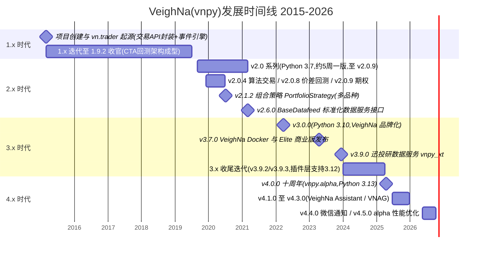
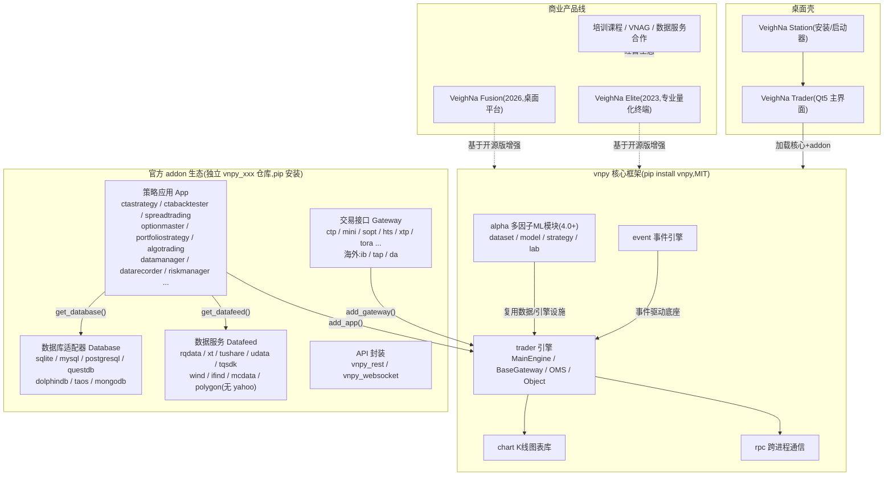

# vnpy(VeighNa)Web 层面深度调研 findings

- 调研日期:2026-10-20
- 调研方式:WebSearch + 网页正文抓取(GitHub README、PyPI、vnpy.com 官方文档/论坛、知乎、CSDN、dev.to 等),未阅读源码仓库内部文件(仅 README 与官方页面)
- 已知基线:45,951 stars,MIT License,最新 release 4.5.0(2026-10-06),GitHub 仓库创建于 2015-03
- 标注约定:【事实】= 来自官方来源或多源一致;【观点】= 单一作者/媒体的主观评价;【低置信】= 单一来源、未交叉验证或信息陈旧

---

## 1. 项目概览与定位

### 1.1 官方一句话定位

【事实】GitHub 主仓 README 的自我定位是「基于 Python 的开源量化交易平台开发框架」,项目对外品牌名为 VeighNa,口号为「By Traders, For Traders, AI-Powered」。[citation:vnpy/vnpy - GitHub](https://github.com/vnpy/vnpy) PyPI 页面描述为「A framework for developing quant trading systems.」。[citation:vnpy · PyPI](https://pypi.org/project/vnpy/)

【事实】官方社区首页 slogan 保留了「你的开源社区量化交易平台 | vn.py | vnpy」的过渡字样,并强调支持大量高性能交易 Gateway 接口(期货、期权、股票、黄金 T+d、银行间固收、外盘市场等)与开箱即用的策略 App 模块。[citation:VeighNa量化社区](https://www.vnpy.com)

### 1.2 项目起源与发展里程碑

【事实】项目起源于国内私募的自主交易系统,2015 年启动时只是交易 API 接口的 Python 封装,早期围绕事件驱动引擎(EventEngine)构建了 vn.trader 交易平台,整合各类国内交易接口与 Interactive Brokers 的三方接口(IbPy)。[citation:VNPY - 百度百科](https://baike.baidu.com/item/VNPY/59208203)、[citation:如何评价 VNPY 量化回测? - BetterBench 的回答 - 知乎](https://www.zhihu.com/question/485765357/answer/2839744534)

版本演进关键节点(时间为官方公告或 PyPI 记录):

| 大版本 | 时间 | 关键内容 |
|---|---|---|
| 1.x 系列 | 2015—2019 | 从 API 封装起步,逐步摸索出事件引擎 + Gateway + CTA 回测的框架;收官版本 1.9.2。官方自述「v1.0 内版本的升级迭代是一步步摸着石头过河」[citation:vnpy/vnpy - GitHub](https://github.com/vnpy/vnpy)、[citation:VNPY源码分析1-vnpy_ctastrategy-运行回测 - 知乎](https://zhuanlan.zhihu.com/p/659315171)。注:1.x 时代各能力(CTA 回测、价差雏形)的确切引入年份未检索到权威逐条记录【低置信】 |
| 2.0 系列 | 2019 起 | 2019 年工作重心转向基于 Python 3.7 的 v2.0,采用约 5 周一版的快速迭代,一年完成 v2.0.0—v2.0.9 共 10 个版本;v2.0.4 引入算法交易、v2.0.8 引入价差回测、v2.0.9 引入期权交易相关能力[citation:2020年vn.py项目计划 - VeighNa量化社区](https://www.vnpy.com/forum/)、[citation:VNPY源码分析1-vnpy_ctastrategy-运行回测 - 知乎](https://zhuanlan.zhihu.com/p/659315171)。注:2.0.0 确切发布日期未检索到直接公告【低置信】 |
| v2.1.2 | 2020 | 引入多标的组合策略模块 PortfolioStrategy(多品种组合实盘能力的起点)[citation:vn.py v2.1.2 - 多标的组合策略 - VeighNa量化社区](https://www.vnpy.com/forum/topic/3111-vn-py-v2-1-2-duo-biao-de-zu-he-ce-lue) |
| v2.6.0 | 2021 | 新增标准化数据服务接口 BaseDatafeed(vnpy.trader.datafeed)与高性能金融数据库,数据服务与数据库适配器开始体系化[citation:vn.py v2.6.0 发布说明 - VeighNa量化社区](https://www.vnpy.com/forum/topic/7705-vn-pyfa-bu-v2-6-0-gao-xing-neng-jin-rong-shu-ju-ku)、[citation:DataFeed 开发手册 - BookStack](https://www.bookstack.cn/read/vnpy-2.9-zh/cece49c642a142e4.md) |
| v3.0.0 | 2022-03-23 | 3.0 大版本首发:核心支持 Python 3.10(兼容 3.7/3.8/3.9),周边插件编译升级;同期项目品牌从 vn.py 升级为 VeighNa[citation:VeighNa发布v3.0.0 - VeighNa量化社区](https://www.vnpy.com/forum/post/53798)、[citation:vn.py 改名 VeighNa 后怎么装? - 知乎](https://zhuanlan.zhihu.com/p/2016984438169416558) |
| v3.7.0 | 2023-04 | 推出 VeighNa Docker,打包 Python 解释器与底层依赖的量化容器镜像[citation:VNPY源码深度拆解 - CSDN](https://blog.csdn.net/weixin_42520374/article/details/165468500)、[citation:VeighNa发布v3.8.0(回顾提及 3.7 Docker)- VeighNa量化社区](https://www.vnpy.com/forum/topic/33323)。注:Docker 发布时间以官方公告回述为准【低置信】 |
| v3.9.0 | 2023-12-14 | 新增迅投研数据服务 vnpy_xt,覆盖国内主要市场 K 线与 Tick 数据[citation:VeighNa发布v3.9.0 - 迅投研数据服务 - VeighNa量化社区](https://www.vnpy.com/forum/topic/32488-veighnafa-bu-v3-9-0-xun-tou-yan-shu-ju-fu-wu) |
| 2024 迭代 | 2024 | 继续在 3.0 大版本上迭代(核心仍为 Python 3.10);v3.9.2 迅投研实时行情、v3.9.3 利星资管接口;期间 vnpy_tap/vnpy_tts 升级 pybind11 封装以支持 Python 3.12 编译[citation:2024年VeighNa项目计划 - VeighNa量化社区](https://www.vnpy.com/forum/post/62892)、[citation:VeighNa发布v3.9.3 - VeighNa量化社区](https://www.vnpy.com/forum/topic/33323-veighnafa-bu-v3-9-3-li-xing-zi-guan-xi-tong-jiao-yi-jie-kou)、[citation:Releases · vnpy/vnpy](https://github.com/vnpy/vnpy/releases) |
| v4.0.0 | 2025-04-10(PyPI)/官方公告口径 2025-04-15 | 项目十周年,「迈向开源量化的下一个十年」;重磅新增面向 AI 量化策略的 vnpy.alpha 模块(受微软 Qlib 启发):dataset 因子特征工程(内置表达式引擎与 Alpha158)、model 统一 API 训练模板(Lasso/LightGBM/MLP)、strategy 截面与时序策略、lab 一站式投研、notebook 投研 Demo;框架核心支持版本升级至 Python 3.13,改用 pyproject.toml、loguru、mypy、ruff[citation:VeighNa发布v4.0.0 - VeighNa量化社区](https://www.vnpy.com/forum/post/67662)、[citation:vnpy/vnpy - GitHub](https://github.com/vnpy/vnpy)、[citation:GitHub Issue #3617 v4.0 开发计划](https://github.com/vnpy/vnpy/issues/3617)、[citation:vnpy · PyPI](https://pypi.org/project/vnpy/) |
| v4.1.0 | 2025-06-17 | 常规迭代[citation:vnpy · PyPI](https://pypi.org/project/vnpy/) |
| v4.2.0 | 2025-11-01 | 常规迭代[citation:vnpy · PyPI](https://pypi.org/project/vnpy/) |
| v4.3.0 | 2025-12-24 | 集成 VeighNa Assistant 智能助手(基于 VNAG 框架,接入内部文档知识库与示例策略)[citation:VeighNa发布v4.3.0(社区公告口径)- VeighNa量化社区](https://www.vnpy.com/forum/)。注:具体公告帖未直接抓取,细节来自搜索摘要【低置信】 |
| v4.4.0 | 2026-05-14 | 新增微信通知功能[citation:VeighNa发布v4.5.0(回顾提及 4.4)- VeighNa量化社区](https://www.vnpy.com/forum/post/70728) |
| v4.5.0 | 2026-10-06(PyPI)/公告 2026-10-13 | 大幅优化多因子模块(vnpy_alpha)时序算子计算性能:重写 ts_mean、ts_std、ts_rank、ts_argmax、ts_argmin、ts_quantile 六个算子(旧版基于 Polars rolling_map);重构因子/信号绩效分析实现[citation:VeighNa发布v4.5.0 - 多因子策略模块性能优化 - VeighNa量化社区](https://www.vnpy.com/forum/post/70728)、[citation:vnpy · PyPI](https://pypi.org/project/vnpy/) |

【事实】2026 年项目主题是「全面拥抱 Agentic AI」,从专用 Agent、通用 Agent、VNAG 课程三条主线推进,并明确把「降低上手门槛、开箱即用」列为重点(官方承认配置复杂、学习成本高是共性痛点)。[citation:2026年VeighNa项目计划 - VeighNa量化社区](https://www.vnpy.com/forum/post/69895)

【事实】当前仓库规模:约 46.0k stars、12.5k forks(2026-10 抓取),与基线 45,951 一致。[citation:vnpy/vnpy - GitHub](https://github.com/vnpy/vnpy)

---

## 2. 官方文档与社区生态

### 2.1 官方站点与文档结构

【事实】官网为 www.vnpy.com(VeighNa量化社区),导航含首页、关于我们、产品 Demo、社区论坛、使用文档、Github、Gitee。官方文档站地址为 **https://www.vnpy.com/docs/**,无需登录,分为三大版本文档:社区版(community)、Elite 版(elite)、Fusion 版(fusion)。[citation:VeighNa量化社区](https://www.vnpy.com)、[citation:VeighNa 使用文档](https://www.vnpy.com/docs/)

【事实】社区版文档包含:交易功能(VeighNa Station、VeighNa Trader、交易接口、数据库、数据服务、PyCharm 开发指南等)、三平台安装指南(Win/Ubuntu/Mac)、16 个策略应用模块说明(CtaStrategy、CtaBacktester、SpreadTrading、OptionMaster、PortfolioStrategy、AlgoTrading、DataRecorder、DataManager、RiskManager、ChartWizard、PaperAccount 等)。[citation:VeighNa 使用文档](https://www.vnpy.com/docs/)、[citation:数据服务 - VeighNa官方文档](https://www.vnpy.com/docs/cn/community/info/datafeed.html)

【事实】官方内容发布渠道还包括微信公众号「VeighNa社区公众号【vnpy-community】」与知乎专栏「VeighNa量化」,版本发布公告通常同步发在论坛与公众号。[citation:VeighNa量化 - 知乎专栏](https://www.zhihu.com/column/vn-py)

### 2.2 品牌化(VeighNa)与商标背景

【事实】2022 年前后项目从 vn.py 品牌升级为 VeighNa,官网与论坛同步改版为「VeighNa量化社区」。[citation:vn.py 改名 VeighNa 后怎么装? - 知乎](https://zhuanlan.zhihu.com/p/2016984438169416558)

【低置信】网络上有讨论称「VNPY」商标由上海量贝信息科技有限公司于 2017 年注册(注册号 35132548),更名或与商标归属争议有关;该因果链来自争议帖与百科条目,未经官方确认。[citation:VNPY - 百度百科](https://baike.baidu.com/item/VNPY/59208203)、[citation:博客园争议文章](https://www.cnblogs.com/vnpy/p/18710832)

### 2.3 商业化形态

【事实】商业化呈「开源社区版 + 付费产品 + 培训课程」三层:

- **VeighNa Elite**:2023-04 发布,定位「面向专业交易员的量化终端」,聚焦期货、期权、证券三大市场,支持海量策略并发、智能移仓换月、算法拆单、多账户等,以独立安装包交付(含 Elite Trader)。[citation:VeighNa Elite - 面向专业交易员的量化终端 - VeighNa量化社区](https://www.vnpy.com/forum/topic/31762-veighna-elite-mian-xiang-zhuan-ye-jiao-yi-yuan-de-liang-hua-zhong-duan)、[citation:VeighNa Elite 面向专业交易员的量化终端 - 知乎](https://zhuanlan.zhihu.com/p/623328614)。具体定价未在公开页面检索到【低置信】
- **VeighNa Fusion**:2026 年一季度推出的商业桌面平台,文档含产品介绍、CTP 连接、CTA 策略、回测与优化、数据中心、风控管理与「智策投研」工作流。[citation:VeighNa 使用文档(Fusion版)](https://www.vnpy.com/docs/)
- **培训课程**:官方通过「Agent 方向小班课」等课程形态经营,2026 年计划中明确 VNAG 课程主线。[citation:2026年VeighNa项目计划 - VeighNa量化社区](https://www.vnpy.com/forum/post/69895)
- **数据服务合作**:官方数据服务文档中 RQData 注册链接直接指向购买页,迅投研以「对大部分个人投资者性价比高」话术推荐,构成生态内商业分发。[citation:数据服务 - VeighNa官方文档](https://www.vnpy.com/docs/cn/community/info/datafeed.html)

### 2.4 社区活跃度

【事实】官方论坛持续有 2026 年的内容:2026-02-15 发布年度项目计划、2026-10-13 发布 v4.5.0 公告,4.x 系列在约 18 个月内发了 6 个 minor 版本,迭代节奏稳定。[citation:2026年VeighNa项目计划 - VeighNa量化社区](https://www.vnpy.com/forum/post/69895)、[citation:VeighNa发布v4.5.0 - VeighNa量化社区](https://www.vnpy.com/forum/post/70728)、[citation:vnpy · PyPI](https://pypi.org/project/vnpy/)

【低置信】论坛用户列表分页达 3132 页(每页约数十用户),据此推测注册量在数万到十万量级;此为间接推算,非官方数字。[citation:用户列表 - VeighNa量化社区](https://www.vnpy.com/forum/memberlist?page=3132&sort_by=username&order_by=asc)

【观点】知乎社区评价认为 vnpy 的社区机制「吸引、聚集了大量亲历者、内行人与领域专家」,是国内量化领域事实上的主流开源社区之一。[citation:量化交易框架vnpy vs backtrader,请大神点评各自优缺点 - 知乎](https://www.zhihu.com/question/418804367/answer/3487619070)

---

## 3. CTA 回测实践(vnpy_ctastrategy BacktestingEngine)

### 3.1 官方定位与组件

【事实】vnpy_ctastrategy 是「针对单标的 CTA 类量化策略设计的应用模块,用于实现 CTA 策略从代码开发、历史回测、参数优化到自动交易的全流程业务功能」;当前版本 1.5.0,支持 Python 3.10—3.13,推荐配合 VeighNa Studio 4.0.0 以上版本。回测引擎位于仓库内 `vnpy_ctastrategy/backtesting.py`。[citation:vnpy/vnpy_ctastrategy - GitHub](https://github.com/vnpy/vnpy_ctastrategy)、[citation:vnpy-ctastrategy · PyPI](https://pypi.org/project/vnpy-ctastrategy/)

【事实】CTA 回测支持 BAR 与 TICK 两种回测模式(`BacktestingMode.BAR` / `BacktestingMode.TICK`),`run_backtesting()` 据此选择 `new_bar` 或 `new_tick` 作为数据回放回调。[citation:VNPY源码分析1-vnpy_ctastrategy-运行回测 - 知乎](https://zhuanlan.zhihu.com/p/659315171)

【事实】回测数据来源为本地 vnpy 数据库(通过 vt_symbol + interval 加载),社区 FAQ 确认「日线数据做日线回测」受支持:导入数据时周期选 daily,回测时 K 线周期选 `d` 即可。[citation:请问 vnpy 支持直接输入日线数据进行日线回测吗 - VeighNa量化社区](https://www.vnpy.com/forum/topic/4996-qing-wen-vnpyzhi-chi-zhi-jie-shu-ru-ri-xian-shu-ju-jin-xing-ri-xian-hui-ce-ma-mei-you-fen-zhong-ji-bie-de-shu-ju)

【观点/工程提示】有实践文章强调 vnpy 回测引擎要求 DataFeed 提供规范的 BarData 结构,「数据源缺字段或时区不对时,回测会静默失败而不报错,只输出错误的绩效数字」——对接外部数据(如 yfinance)时需重点校验字段与时区。[citation:vnpy 回测引擎 DataFeed 与 BarData 结构实践 - 掘金](https://juejin.cn/post/7638584180326514722)

### 3.2 无 GUI 程序化回测:官方与社区实践

【事实】**无 GUI 脚本回测是官方设计支持的能力,且有明确社区实践先例**,证据链如下:

1. **官方开发手册提供了「单策略回测示例」**:直接 `import BacktestingEngine` + 策略类,`set_parameters()` 设置合约、周期、起止日期、手续费率、滑点、合约乘数、初始资金,再依次调用 `load_data()` → `run_backtesting()` → `calculate_result()` → `calculate_statistics()`(传 `output=True` 打印统计)。[citation:单策略回测示例 - vn.py 2.1 开发手册 - BookStack](https://www.bookstack.cn/read/vnpy-2.1/spilt.7.spilt.4.64caaaef7c5fb2e1.md)
2. **两个易混类的官方辨析**:`BacktestingEngine`(位于 `vnpy_ctastrategy.backtesting`,无继承)是可独立运行的回测引擎,负责运行策略、调用 Bar/Tick 数据、处理交易;`BacktesterEngine` 才是带 GUI 的回测管理引擎。脚本回测直接用前者即可。[citation:VNPY 的 BacktesterEngine 和 BacktestingEngine 的区别 - 博客园](https://www.cnblogs.com/kingkaixuan/p/17242966.html)
3. **社区早在 2020 年就有「不用打开 GUI 的回测脚本」讨论帖**。[citation:自己写了个回测的脚本,回测时不用打开 GUI 界面比较方便 - VeighNa量化社区](https://www.vnpy.com/forum/topic/2567-zi-ji-xie-liao-ge-hui-ce-de-jiao-ben-hui-ce-shi-bu-yong-da-guijie-mian-bi-jiao-fang-bian)
4. **存在专门的无界面回测开源项目**(jinwukong/vnpy-backtest-demo,自述「基于 vnpy 开源代码的无界面回测引擎」,演示 RQData 下载数据到本地 SQLite 后脚本回测)。[citation:jinwukong/-vnpy-backtest-demo - GitHub](https://github.com/jinwukong/-vnpy-backtest-demo)
5. **CSDN 有「vnpy 极简版本,无 UI 启动策略」的教程**,展示不启动 UI 直接引用策略、加载数据、回测并画图的脚本方式。[citation:vnpy 极简版本,无 UI 启动策略 - CSDN](https://quant.csdn.net/6874bf64bb9d8e0ecec2371f.html)
6. **绕过付费数据源的本地 CSV 路线也是常见实践**:将外部数据(CSV)导入 `.vntrader` 下的 SQLite 数据库后回测,避免依赖内置 RQData。[citation:vn.py 基于本地 CSV 数据的历史回测 - CSDN](https://blog.csdn.net/FrankieHello/article/details/98797967)

综合以上,「纯 Python 脚本/notebook 直接调 BacktestingEngine」是社区成熟惯例,标准代码模式如下(依据官方手册与社区文章整理):

```python
from datetime import datetime
from vnpy_ctastrategy.backtesting import BacktestingEngine, BacktestingMode
from vnpy_ctastrategy.strategies.double_ma_strategy import DoubleMaStrategy

engine = BacktestingEngine()
engine.set_parameters(
    vt_symbol="IF888.CFFEX",      # 数据库中的合约代码
    interval="d",                 # 1m/1h/d/tick,日线为 "d"
    start=datetime(2023, 1, 1),
    end=datetime(2023, 12, 31),
    rate=0.3/10000,               # 手续费率
    slippage=0.2,
    size=300,                     # 合约乘数
    pricetick=0.2,
    capital=1_000_000,
    mode=BacktestingMode.BAR,
)
engine.add_strategy(DoubleMaStrategy, {"fast_window": 10, "slow_window": 60})
engine.load_data()
engine.run_backtesting()
engine.calculate_result()
engine.calculate_statistics(output=True)
engine.show_chart()   # plotly 资金曲线;纯服务器环境可省略
```

[citation:单策略回测示例 - vn.py 2.1 开发手册 - BookStack](https://www.bookstack.cn/read/vnpy-2.1/spilt.7.spilt.4.64caaaef7c5fb2e1.md)、[citation:VNPY源码分析1-vnpy_ctastrategy-运行回测 - 知乎](https://zhuanlan.zhihu.com/p/659315171)

【观点】需注意的边界:CTA 引擎为**单标的**回测设计,多因子选股/多标的组合需用 portfolio 模块或自行扩展;社区文章称其性能不如向量化框架(有作者给出「数据读取比 VectorBT 慢 6 倍以上」的量级对比,未经独立验证)。[citation:Backtrader vs VnPy vs Qlib: A Deep Comparison - dev.to](https://dev.to/linou518/backtrader-vs-vnpy-vs-qlib-a-deep-comparison-of-python-quant-backtesting-frameworks-2026-3gjl)

---

## 4. 数据源生态

### 4.1 官方 datafeed 适配器清单

【事实】自 v2.6.0 引入标准化 `BaseDatafeed` 接口后,数据服务通过全局配置 `datafeed.name` / `datafeed.username` / `datafeed.password`(token 写入 password 字段)接入。官方文档列出 8 个数据服务,均需注册:[citation:vn.py v2.6.0 发布说明 - VeighNa量化社区](https://www.vnpy.com/forum/topic/7705-vn-pyfa-bu-v2-6-0-gao-xing-neng-jin-rong-shu-ju-ku)、[citation:数据服务 - VeighNa官方文档](https://www.vnpy.com/docs/cn/community/info/datafeed.html)

| 适配器 | 仓库 | 资产覆盖 | 周期 | 注册/收费 |
|---|---|---|---|---|
| 迅投研 xt | vnpy_xt(v3.9.0 引入) | 股票、期货、期权、基金、财务信息 | 日/小时/分钟/Tick(实时) | 需注册 |
| RQData 米筐 | vnpy_rqdata | 股票、期货、期权、基金、黄金 TD | 日/小时/分钟/Tick | 需注册(购买页) |
| UData 恒有数 | vnpy_udata | 股票、期货 | 分钟(盘后更新) | 需注册 |
| TuShare | vnpy_tushare | 股票、期货 | 日/分钟(盘后更新) | 需注册(tushare.pro) |
| TQSDK 天勤 | vnpy_tqsdk | 期货 | 分钟(实时) | 需注册 |
| Wind 万得 | vnpy_wind | 期货 | 分钟(实时) | 商业终端 |
| iFinD 同花顺 | vnpy_ifind | 期货 | 分钟(实时) | 商业终端 |
| Tinysoft 天软 | vnpy_tinysoft | 期货 | 分钟(实时) | 商业终端;不支持 Python 3.10 |

[citation:数据服务 - VeighNa官方文档](https://www.vnpy.com/docs/cn/community/info/datafeed.html)

【事实】README 的官方 datafeed 插件列表还包括 vnpy_mcdata、vnpy_polygon 等;注意 **官方 datafeed 清单中没有 Yahoo/yfinance 适配器**。[citation:vnpy/vnpy - GitHub](https://github.com/vnpy/vnpy)

【事实】数据库适配器(另一个维度)包括 sqlite、mysql、postgresql、questdb、dolphindb、taos、mongodb;社区有通过 `get_datafeed()` / `get_database()` / `get_bar_overview()` 做全市场批量数据下载的工程化示例。[citation:vnpy/vnpy - GitHub](https://github.com/vnpy/vnpy)、[citation:全市场期货数据批量下载与更新示例代码 - VeighNa量化社区](https://www.vnpy.com/forum/post/62345)

### 4.2 yfinance 拉美股日频数据做回测:可行性与常见坑

【事实】**没有官方或被广泛使用的 `vnpy_yfinance` datafeed 包**(PyPI 与 GitHub 检索均未发现);要用 Yahoo 数据接 vnpy,需自建 datafeed 或「下载后写入 vnpy 数据库」两条路线,后者是社区更常见的做法。[citation:vnpy/vnpy - GitHub](https://github.com/vnpy/vnpy)、[citation:vn.py 基于本地 CSV 数据的历史回测 - CSDN](https://blog.csdn.net/FrankieHello/article/details/98797967)

【事实】yfinance 数据获取端本身成熟(「一行代码,秒级返回」,支持美股、港股 `.HK` 后缀、外汇、加密货币等),作为回测数据源可行性高,但存在以下已证实的坑:[citation:量化投资从入门到入土:可能你的策略从数据就开始出问题了 - 知乎](https://zhuanlan.zhihu.com/p/1973769828771862363)、[citation:yfinance 获取美股数据避坑指南 - 知乎](https://zhuanlan.zhihu.com/p/2073730873204150927)

1. **复权/auto_adjust 默认值变化(最大的坑)**:约 v0.2.51 起 `auto_adjust` 默认从 False 改为 True,返回的 DataFrame 中 `Adj Close` 列消失,`Close` 列含义变为「已复权价」;旧代码迁移后回测结果可能被静默改变。需要原始价时显式传 `auto_adjust=False`。另注意 Yahoo 的 Adjusted Close 只是后复权价格,其百分比变化是总收益的近似,不等于严格的总回报指数。[citation:Why Adj Close Disappeared in yfinance (And How to Adapt) - Medium](https://medium.com/@josue.monte/why-adj-close-disappeared-in-yfinance-and-how-to-adapt-6baebf1939f6)、[citation:yfinance Library - A Complete Guide - AlgoTrading101](https://algotrading101.com/learn/yfinance-guide)、[citation:GitHub issue #2070](https://github.com/ranaroussi/yfinance/issues/2070)
2. **时区坑**:返回索引是 timezone-aware(美股为 America/New_York);Yahoo 数据曾有 EST→UTC 的口径变化(issue #2327),日线日期标签会偏移;`end` 参数不包含当天,且时区解释不一致时可能丢最后一天数据。建议 `ignore_tz=True` 或 `tz_convert("America/New_York").tz_localize(None)` 后入库。这与上节「vnpy 对时区/字段敏感,错误会静默失败」的提示叠加,是接入时的首要校验点。[citation:GitHub issue #2327](https://github.com/ranaroussi/yfinance/issues/2327)、[citation:yfinance 常见问题与解决方案 - infoway](https://blog.infoway.io/yfinance-common-issues-solutions)、[citation:vnpy 回测引擎 DataFeed 与 BarData 结构实践 - 掘金](https://juejin.cn/post/7638584180326514722)
3. **symbol 格式**:Yahoo 用 `BRK-B`(连字符)而非 `BRK.B`;指数必须带 `^` 前缀(如 `^GSPC`);港股为 4 位补零 + `.HK`(如 `0388.HK`);加密货币为 `BTC-USD`。批量下载多标的返回多级列索引,建议 `group_by="ticker"`。接 vnpy 时需做一层 symbol 规范化映射(如 `BRK.B → BRK-B`)。[citation:Yahoo Finance BRK-B 页面](https://finance.yahoo.com/quote/BRK-B)、[citation:yfinance download 官方参考](https://ranaroussi.github.io/yfinance/reference/api/yfinance.download.html)
4. **接口稳定性/限流**:yfinance 非官方 API,抓取 Yahoo 网页端点,Yahoo 按 IP 与 TLS 指纹限流封禁;2025 年多次出现 `YFRateLimitError`(v0.2.54 引入 curl_cffi 缓解,v0.2.57 复发后再修;新版依赖 curl-cffi,conda 环境易装不上);云平台共享 IP 常被长期封锁,需代理或自建出口。结论:**适合 demo/研究,不适合对可用性敏感的生产数据通道**,工程上应加缓存、退避重试与降级方案。[citation:GitHub issue #2422](https://github.com/ranaroussi/yfinance/issues/2422)、[citation:Why yfinance Keeps Getting Blocked - Medium](https://medium.com/@trading.dude/why-yfinance-keeps-getting-blocked-and-what-to-use-instead-92d84bb2cc01)、[citation:在国内通过代理访问 yfinance - 博客园](https://www.cnblogs.com/outs/p/19070732)
5. **复权数据回溯变动**:每次除息后整段历史复权价都会重算,本地缓存与最新拉取的数据不可直接拼接。[citation:量化投资从入门到入土:可能你的策略从数据就开始出问题了 - 知乎](https://zhuanlan.zhihu.com/p/1973769828771862363)

### 4.3 S&P500 基准线:^GSPC 还是 SPY

【事实】两者语义不同:`^GSPC` 是价格指数(不含股息),SPY 是可交易 ETF(约 0.09% 费率,按季分红)。用 SPY 原始 close 与 ^GSPC 直接比较会出现明显口径差;公平比较只有两种:SPY 复权后 close(分红再投)对照 ^GSPC,或 ^GSPC 对照 SPY 原始 close。[citation:Why the difference between SPY and ^GSPC? - Quant StackExchange](https://quant.stackexchange.com/questions/18201/why-the-difference-between-spy-and-gspc)、[citation:SPX vs SPY: What's the Difference? - ETF.com](https://www.etf.com/sections/etf-basics/spx-vs-spy-whats-difference)

【观点/惯例】社区常见模式是「用 ^GSPC 的指数值做信号/基准,用 SPY 作为实际交易工具」(指数不可直接交易);若只画一条基准曲线且策略按复权收益计算,用 **SPY 的 Adjusted Close** 更贴近可实现的基准收益;若强调「跑赢指数本身」,则用 ^GSPC 并注明其为价格收益口径。[citation:Backtesting a Forecasting Strategy for the S&P500 - QuantStart](https://www.quantstart.com/articles/Backtesting-a-Forecasting-Strategy-for-the-SP500-in-Python-with-pandas)、[citation:SPY vs SPX - Investing in the Web](https://investingintheweb.com/education/spy-vs-spx)

---

## 5. Python 版本支持演进

【事实】各阶段的官方口径:

| 时期 | 核心支持的 Python | 来源 |
|---|---|---|
| 1.x 时代 | Python 2.7 / 3.x 双轨(具体分界未检索到权威记录)【低置信】 | — |
| v2.0(2019) | Python 3.7 | [citation:2020年vn.py项目计划 - VeighNa量化社区](https://www.vnpy.com/forum/) |
| v3.0.0(2022-03) | Python 3.10(兼容 3.7/3.8/3.9) | [citation:VeighNa发布v3.0.0](https://www.vnpy.com/forum/post/53798) |
| 2024 全年(3.x 尾期) | 仍以 Python 3.10 为核心;插件层(vnpy_tap/vnpy_tts)经 pybind11 升级后支持 3.12 编译 | [citation:2024年VeighNa项目计划](https://www.vnpy.com/forum/post/62892)、[citation:Releases · vnpy/vnpy](https://github.com/vnpy/vnpy/releases) |
| v4.0.0(2025-04) | 3.10—3.13,推荐 Python 3.13 | [citation:GitHub Issue #3617](https://github.com/vnpy/vnpy/issues/3617)、[citation:vnpy/vnpy - GitHub](https://github.com/vnpy/vnpy) |
| **v4.5.0(2026-10,当前)** | **Requires Python >=3.10(支持 3.10—3.13,64 位),推荐 3.13** | [citation:vnpy · PyPI](https://pypi.org/project/vnpy/)、[citation:vnpy/vnpy - GitHub](https://github.com/vnpy/vnpy) |

**结论:vnpy 4.5.0 对 Python 3.12 完全支持**(处在官方 3.10—3.13 支持区间内);4.0 起插件生态已完成 4.x 兼容升级(涉及 C++ API 封装的模块必须升级)。[citation:vnpy/vnpy - GitHub](https://github.com/vnpy/vnpy)

【低置信】2023 年前后有 Mac M2 + Python 3.12 安装问题的社区反馈,属早期版本个案,不反映 4.x 现状。[citation:veighnapy 手动安装经验总结 - VeighNa量化社区](https://www.vnpy.com/forum/post/64685)

---

## 6. 同类库对比

### 6.1 五库定位对比表

| 维度 | vnpy(VeighNa) | backtrader | qlib | vectorbt | zipline-reloaded |
|---|---|---|---|---|---|
| 定位 | 全栈量化交易平台(交易接口+实盘+回测) | 事件驱动回测引擎 | AI 量化研究平台(微软) | 向量化回测/参数扫描引擎 | Pipeline 式研究回测框架(Quantopian 后继) |
| 维护方 | 社区 + 上海团队(vnpyproject) | 独立开发者 mementum | 微软亚洲研究院 | polakowo(开源版)/PRO 团队 | Stefan Jansen |
| 维护状态(2025-2026) | 活跃,4.x 半年一版,2026 主题 Agentic AI | 2019 年起基本停滞,有 Python 3.10+ 兼容问题 | 活跃,持续集成 RL/LLM | 开源版冻结于 0.28.1,重心转付费 VectorBT PRO | 维护模式(bug/安全/兼容),新功能转向 ML4T |
| 回测范式 | 事件驱动(逐 bar/tick) | 事件驱动 | AI 研究管线(因子→模型→回测) | 向量化(NumPy/Numba) | 事件驱动 + Pipeline |
| 实盘能力 | 强(CTP/IB 等 30+ gateway) | 弱(需自接 broker) | 弱(需桥接券商 API) | 无 | 无 |
| 数据面 | 插件化 database/datafeed,官方数据源偏国内市场 | 自备数据 | 内置 A 股数据集 | 自备数据 | 自备数据(bundle 机制) |
| 上手成本 | 高(官方承认配置复杂,社区称需 1-2 周) | 低(30 行代码出结果) | 高(需 ML+量化双基础) | 中(API 密集) | 中 |
| Python | 3.10—3.13 | 3.10+ 兼容性差 | 3.x | 3.x | 3.7+ |

[citation:vnpy/vnpy - GitHub](https://github.com/vnpy/vnpy)、[citation:2026年VeighNa项目计划](https://www.vnpy.com/forum/post/69895)、[citation:Backtrader vs VnPy vs Qlib: A Deep Comparison - dev.to](https://dev.to/linou518/backtrader-vs-vnpy-vs-qlib-a-deep-comparison-of-python-quant-backtesting-frameworks-2026-3gjl)、[citation:zipline-reloaded - GitHub](https://github.com/stefan-jansen/zipline-reloaded)、[citation:polakowo/vectorbt - GitHub](https://github.com/polakowo/vectorbt)、[citation:Backtrader vs NautilusTrader vs VectorBT vs Zipline - AutoTradeLab](https://autotradelab.com/blog/backtrader-vs-nautilusttrader-vs-vectorbt-vs-zipline-reloaded)、[citation:量化开源项目对比 Backtrader, VectorBT, Zipline, vnpy, wtpy - CSDN](https://blog.csdn.net/zhangyunchou2015/article/details/147185325)

【观点】dev.to 对比文的结论是三者「不是竞争替代,而是不同阶段工具」:学习期 backtrader、研究期 qlib、生产准备 vnpy;并给出 vnpy 相比 DolphinDB/VectorBT 的性能倍数量级(未经独立验证,量级仅供参考)。[citation:Backtrader vs VnPy vs Qlib - dev.to](https://dev.to/linou518/backtrader-vs-vnpy-vs-qlib-a-deep-comparison-of-python-quant-backtesting-frameworks-2026-3gjl)

### 6.2 对本 demo 场景的适配度(FastAPI 回测服务 + 日频美股 + 常见指标策略)

【观点】综合判断(低适配,给 vnpy 2/5 分的理由):

1. **市场错位**:vnpy 的数据生态与 gateway 生态(CTP、迅投研、RQData 等)以国内市场为中心,美股仅覆盖 IB 等交易接口;日频美股数据需靠 yfinance 自建 datafeed 或自行写库,而官方 datafeed 清单无 Yahoo 支持。[citation:数据服务 - VeighNa官方文档](https://www.vnpy.com/docs/cn/community/info/datafeed.html)、[citation:vnpy/vnpy - GitHub](https://github.com/vnpy/vnpy)
2. **重**:平台型框架含事件引擎、gateway、OMS、GUI(VeighNa Trader/VeighNa Station)等大量与本 demo 无关的组件;官方 2026 年计划自认「配置太复杂、学习成本高」是待解决问题。FastAPI 回测服务场景只需要一个回测内核,vnpy 显著过重。[citation:2026年VeighNa项目计划](https://www.vnpy.com/forum/post/69895)、[citation:量化开源项目对比 - CSDN](https://blog.csdn.net/zhangyunchou2015/article/details/147185325)
3. **性能**:事件驱动逐 bar 引擎在日频单标的上完全够用,但多标的批量回测服务的吞吐不如 vectorbt 类向量化引擎;CTA 引擎单标的限制对多品种组合回测不友好。[citation:Backtrader vs VnPy vs Qlib - dev.to](https://dev.to/linou518/backtrader-vs-vnpy-vs-qlib-a-deep-comparison-of-python-quant-backtesting-frameworks-2026-3gjl)
4. **可取之处**:若 demo 想强调「回测与实盘同构」「工程级事件驱动架构」或未来要接国内期货实盘,vnpy 的 `BacktestingEngine` 无 GUI 脚本回测可直接嵌入 FastAPI 后台线程(成熟做法见第 3 节),策略模板(CtaTemplate)的 on_bar/on_init 生命周期对实现「常见指标策略」也足够清晰。[citation:单策略回测示例 - BookStack](https://www.bookstack.cn/read/vnpy-2.1/spilt.7.spilt.4.64caaaef7c5fb2e1.md)、[citation:vnpy 极简版本,无 UI 启动策略 - CSDN](https://quant.csdn.net/6874bf64bb9d8e0ecec2371f.html)

【观点】同类场景下 backtrader(易用、美股社区资料多、但停止维护)与 vectorbt(批量参数扫描快、开源版冻结)通常比 vnpy 更贴合;vnpy 的不可替代性在于国内实盘接入。[citation:量化交易框架vnpy vs backtrader - 知乎](https://www.zhihu.com/question/418804367/answer/2703351010)、[citation:Backtrader vs NautilusTrader vs VectorBT vs Zipline - AutoTradeLab](https://autotradelab.com/blog/backtrader-vs-nautilusttrader-vs-vectorbt-vs-zipline-reloaded)

---

## 7. 社区评价

### 7.1 公认优点

【事实/观点混合】

- 完整度高:从交易接口到回测、数据管理、风控的全流程覆盖,「完整但不完善」是知乎高赞回答的代表性评价。[citation:量化交易框架vnpy vs backtrader - 知乎](https://www.zhihu.com/question/418804367/answer/61226182618)
- 起源实战:源于国内私募自主交易系统,一键本地部署、开源。[citation:如何评价 VNPY 量化回测? - 知乎](https://www.zhihu.com/question/485765357/answer/2839744534)
- 国内 CTP 期货对接成熟,是国内期货/证券量化的事实标准之一。[citation:Backtrader vs VnPy vs Qlib - dev.to](https://dev.to/linou518/backtrader-vs-vnpy-vs-qlib-a-deep-comparison-of-python-quant-backtesting-frameworks-2026-3gjl)
- 回测到实盘代码同构,同一份策略代码可直接上线;Qt5 GUI 回测不依赖 Jupyter。[citation:Backtrader vs VnPy vs Qlib - dev.to](https://dev.to/linou518/backtrader-vs-vnpy-vs-qlib-a-deep-comparison-of-python-quant-backtesting-frameworks-2026-3gjl)

### 7.2 公认缺点

【观点】

- 偏重、学习曲线陡:定位平台,学习成本高于纯回测框架;官方 2026 计划也承认配置复杂。[citation:量化开源项目对比 - CSDN](https://blog.csdn.net/zhangyunchou2015/article/details/147185325)、[citation:2026年VeighNa项目计划](https://www.vnpy.com/forum/post/69895)
- 迭代过快带来的版本变动与学习成本(「由于 VNPY 团队太勤奋」的调侃)。[citation:如何评价 VNPY 量化回测? - 知乎](https://www.zhihu.com/question/485765357/answer/2839744534)
- 纯回测场景不如轻量框架直接,有人推荐 backtesting.py 等极简替代。[citation:量化交易框架vnpy vs backtrader - 知乎](https://www.zhihu.com/question/418804367/answer/1889084953075110118)
- CTA 引擎单标的限制、ML 集成弱。[citation:Backtrader vs VnPy vs Qlib - dev.to](https://dev.to/linou518/backtrader-vs-vnpy-vs-qlib-a-deep-comparison-of-python-quant-backtesting-frameworks-2026-3gjl)

### 7.3 2025—2026 活跃度与维护状态

【事实】维护状态活跃且有公开路线图:4.x 在 2025-04 至 2026-10 发布 6 个 minor 版本(4.0.0/4.1.0/4.2.0/4.3.0/4.4.0/4.5.0);2026 年计划明确 Agentic AI(专用 Agent、通用 Agent、VNAG 课程)与易用性改造两大主线;商业线(Elite、Fusion)持续投入。[citation:vnpy · PyPI](https://pypi.org/project/vnpy/)、[citation:2026年VeighNa项目计划](https://www.vnpy.com/forum/post/69895)

【事实】核心团队工程化升级:4.0 起统一 pyproject.toml、引入 loguru/mypy/ruff,addon 生态逐步完成 4.x 兼容。[citation:GitHub Issue #3617](https://github.com/vnpy/vnpy/issues/3617)、[citation:vnpy/vnpy - GitHub](https://github.com/vnpy/vnpy)

---

## 8. Mermaid 图

### 8.1 发展时间线(gantt)



注:2.0.0 与 1.x 各能力的精确日期缺权威记录,图中位置为区间示意【低置信】;4.0.0 PyPI 日期为 2025-04-10,官方公告口径为 2025-04-15。

### 8.2 生态架构(vnpy 核心与 addon 的关系)



---

## 9. 事实 / 观点 / 低置信信息清单

**已验证事实(多源一致)**:4.5.0 于 2026-10-06 上 PyPI,Requires Python >=3.10(支持 3.10—3.13,推荐 3.13);v3.0.0 于 2022-03-23 发布且核心 Python 3.10;v2.6.0 引入 BaseDatafeed;官方 datafeed 清单无 Yahoo/yfinance;官方文档站 https://www.vnpy.com/docs/;Elite 2023-04 发布;无 GUI 脚本回测有官方手册与多个社区实践佐证。

**观点(dev.to、知乎、CSDN 作者)**:性能对比倍数;「完整但不完善」;阶段工具论;对本 demo 场景适配度评分。

**低置信信息(单一来源或推断,引用时需谨慎)**:
1. 「VNPY 商标 2017 年由上海量贝注册并与更名存在因果」——来自争议帖与百科,无官方确认。
2. 1.x 时代各能力(CTA、价差)引入年份与 1.9.2 收官时间——未找到逐条权威记录。
3. v2.0.0 确切发布日期(2019 年内但月份未证实)。
4. VeighNa Fusion「2026 年一季度发布」——单一搜索来源,未抓到官方发布公告原文。
5. 4.3.0「VeighNa Assistant / VNAG」细节——来自搜索摘要,未直接抓取官方公告。
6. 论坛注册用户量级——由用户列表分页数推算。
7. 「vnpy 曾有 vnpy_yahoo datafeed」——检索未找到官方包,不可作为事实引用。
8. Elite 具体定价——公开页面未检索到。
