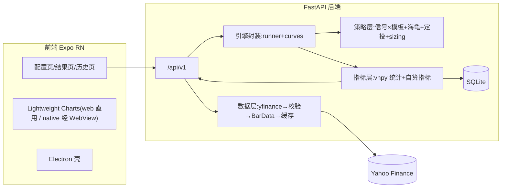

# vnpy 量化回测 Demo 设计 Spec

- 日期:2026-10-20
- 状态:**已批准**(用户 2026-10-20 确认「批准,自主推进到 goal」)
- 研究依据:docs/research/vnpy-code-findings.md、docs/research/vnpy-web-findings.md、docs/research/2026-10-20-vnpy-deep-research.md
- 指标需求:docs/回测指标.tmp

## 1. 目标与范围

基于 vnpy 4.5.0 构建量化回测 demo:yfinance 拉取美股日频数据,FastAPI 后端程序化驱动 vnpy CTA 回测引擎执行回测,Expo React Native 前端展示结果(TradingView 可交互图表)。

**支持**:
- 指定美股标的 + 日期范围拉取日频数据
- 指定初始资金;8 种策略形态(见 §5)
- 信号形态买入量 = 总资金或剩余现金的指定百分比,股数下取整
- 8 项指标(docs/回测指标.tmp)+ vnpy 原生统计
- 总资金 / 持仓资金 / S&P500 buy&hold 三线累计收益率对比(起点 0 = 坐标原点)
- TradingView 可交互 K 线 + EMA 叠加 + MACD/KDJ 副图
- 回测历史落库与查询
- 前后端 Docker 分别打包;桌面端 = web build + Electron 壳

**非目标(明确排除)**:实盘/模拟盘交易、多标的组合回测、异步任务队列、用户系统与鉴权、tick 级数据、期权期货。

## 2. 决策记录

| # | 决策 |
|---|---|
| D1 | Python 3.12,uv 管理 |
| D2 | FastAPI 程序化驱动 `vnpy_ctastrategy.backtesting.BacktestingEngine`(无 GUI、无 EventEngine/MainEngine/Gateway) |
| D3 | Expo 一套代码覆盖 iOS+Android+Web;桌面 = Electron 加载 web build;图表 TradingView Lightweight Charts |
| D4 | 信号源三选一(MACD/KDJ/双指定 EMA);EMA 快慢周期用户指定 |
| D5 | 默认成本:佣金率 0.1%/笔 + 滑点 0.01 美元/股(vnpy slippage 语义为**每股绝对值**,非比率);佣金率/滑点可配。**不含固定佣金/笔**——vnpy_ctastrategy(实钉 1.4.1,PyPI 无 1.5.0,tag diff 无 API 差异)引擎不支持,策略侧自扣会致资金曲线失真(Task 0 内省证实) |
| D6 | 海龟 = 经典 ATR 单位制,不受百分比规则约束;百分比规则仅适用于信号形态 |
| D7 | 定投 = 固定金额 + 间隔(每周/每两周/每月首个交易日),持有到期 |
| D8 | 回测同步返回 + SQLite 落库可查历史 |
| D9 | 远程 `git@github.com:noire02qwq/vnpy-demo.git`,身份 noire02qwq,SSH,实时提交推送 |
| D10 | 基准 `benchmark_symbol` 默认 `^GSPC`,可切 `SPY`(web 调研:^GSPC 价格指数不含股息,SPY 更贴近可实现收益) |

## 3. 总体架构



单标的单策略回测,与 vnpy CTA 引擎单标的语义天然一致。回测同步执行(日频几千根 bar,毫秒级)。

## 4. 数据层规格(backend/app/data/)

### 4.1 抓取(yahoo.py)
- `yfinance.download(symbol, start=, end=end+1天, auto_adjust=True, progress=False)`——end 参数不含当天,显式 +1 天;Close 即复权价(无 Adj Close 列)
- 多级尝试:先 `period` 失败再用 `Ticker.history`;限流错误归一化为 `RATE_LIMITED`
- 时区:统一转换为美东 `America/New_York` 后剥离 tzinfo

### 4.2 校验(validate.py)
- OHLC 一致性:high ≥ max(open,close),low ≤ min(open,close);volume ≥ 0;NaN 行剔除并记录
- 行数下限:`warmup_bars + 10`,不足报 `RANGE_TOO_SHORT`
- symbol 规则:`^[A-Z]{1,5}(-[A-Z])?$` 或 `^\^GSPC$`、`^SPY$` 等白名单扩展

### 4.3 BarData 转换(bars.py)
- vnpy `BarData`:symbol、exchange=Exchange.SMART(占位)、datetime=**交易日 00:00(美东,已剥 tz)**、interval=Interval.DAILY、open/high/low/close/volume=float
- 输出按 datetime 升序 list[BarData],直接注入 `engine.history_data`(尽调确认 run_backtesting 只迭代该字段,绕过 vnpy 数据库,无需 vnpy_sqlite)

### 4.4 缓存(cache.py)
- 路径 `data/cache/{symbol}_{start}_{end}_{download_date}.parquet`;复权价随除息回溯变动 → 缓存键含下载日期戳,禁止跨区间拼接
- TTL 默认 7 天(pydantic-settings 可配);命中直接读 parquet,未命中拉取后写

## 5. 策略层规格(backend/app/strategies/)

### 5.1 信号源(signals.py,纯函数,输入 ArrayManager)
| 信号 | 定义 | 参数 |
|---|---|---|
| MacdSignal | DIF 上穿/下穿 DEA(DIF_t>DIF_{t-1} 且前值 ≤) | fast=12, slow=26, signal=9 |
| KdjSignal | K 上穿/下穿 D。RSV=(C−L9)/(H9−L9)×100,K=SMA(RSV,3,1),D=SMA(K,3,1),J=3K−2D(**精确自算**,ArrayManager 无 KDJ) | n=9, m1=3, m2=3 |
| EmaCrossSignal | EMA_fast 上穿/下穿 EMA_slow | fast, slow(用户指定) |

输出 `SignalResult{direction: +1|−1|0, series: 各分量时序}`(series 供前端副图)。

### 5.2 仓位引擎(sizing.py)
- 策略自管现金:`cash` 初始 = capital;**以 on_trade 回报的实际成交价**(非委托价)按 `成交额 + 佣金 + 滑点成本` 扣减,卖出加回;与 §6.2 由引擎 daily_df 推导的 cash_t 必须逐日一致(§11 资金守恒测试钉住)
- 信号形态买入:`budget = (cash 或 equity) × entry_pct`,**股数按决策 bar 收盘价折算** `shares = floor(budget / close_t)`;实际成交在 t+1 开盘价,现金扣减以 on_trade 实际回报校准(允许与 budget 有小额偏差);`entry_basis ∈ {total, cash}`;shares=0 则跳过并记录
- 仅信号形态适用 entry_pct/entry_basis;海龟/定投按各自规则

### 5.3 策略模板
1. **CrossTradeStrategy**(×3 信号源 = 3 形态):on_bar 收到金叉 → 按 sizing 买入(仅空仓时);死叉 → **卖出 `sell_pct`%(默认 100,可配)`floor(pos×sell_pct/100)` 股,不足 1 股跳过**。通用兜底(全部策略):买入前现金不足 1 股价不下单;卖出股数以实际持仓为上界,不足 1 股不卖。TP/SL 与海龟的止损/通道离场为保护性出场,保持全仓不变。
2. **CrossTpslStrategy**(×3 信号源 = 3 形态):金叉 → 按 sizing 发限价买单;on_trade 得到实际成交价后挂**止盈限价卖单**(成交价×(1+take_profit_pct))与**止损 vnpy stop 卖单**(成交价×(1−stop_loss_pct))。全部出场经引擎撮合(禁止策略内自判成交绕过引擎,否则 §6.2 net_pnl 曲线失真);vnpy 日频撮合下:止损单在 bar 触发价内触发,止盈限价单依赖开盘跳空触及,**死叉清仓作为兜底出场**;空仓后金叉可再入场。
3. **TurtleStrategy**:唐奇安 entry/exit 通道(默认 20/10,可配)+ ATR(20);`unit_shares = floor((equity × 1%) / ATR)`(经典 1N 风险),最多 4 单元(突破加仓间隔 0.5N);总止损 = 最近入场价 − 2N,挂 vnpy stop 单全平;通道反向跌破 → 限价清仓并撤销止损单;做多 only(美股无融券,不做空)。
4. **DcaStrategy**:间隔 `weekly|biweekly|monthly`,锚定区间首个交易日所在周/月,每间隔首个交易日按固定 `amount` 买入 `floor(amount/price)` 股;现金不足一股则跳过;持有到期不清仓。

全部为 vnpy `CtaTemplate` 子类(可独立于本服务回测);vnpy 撮合语义:t 日 on_bar 挂单 → **t+1 开盘价撮合**(min/max 委托价,开盘价)。

### 5.4 暖机
**不预置区间外数据**:history_data = 用户区间全部 bar;区间前 `warmup_bars` 根(默认 100,可配)仅由策略内 ArrayManager 消化,`am.inited` 之前不下任何单。数据校验要求行数 ≥ warmup_bars + 10(RANGE_TOO_SHORT)。equity 曲线从区间首日起算,首日 = 初始资金(对比线原点)。

## 6. 引擎封装与曲线导出(backend/app/engine/)

### 6.1 runner.py
```
set_parameters(vt_symbol, interval=DAILY, capital, rate=0.001, slippage=0.0005, size=1, pricetick=0.01, fixed=0)
add_strategy(策略类, settings=用户参数)
engine.history_data = bar_list      # 绕过 load_data/数据库
run_backtesting() → calculate_result() → stats = calculate_statistics()
```
固定 `size=1`(美股按股)、`pricetick=0.01`。

### 6.2 curves.py(每日净值导出)
- `equity_t = capital + cumsum(daily_df.net_pnl)`(尽调确认 balance 即此还原)
- `pos_t` 由 `get_all_trades()` 按日重放累计(策略无关,单点真源)
- `position_value_t = pos_t × close_t`(close 取 daily_results);`cash_t = equity_t − position_value_t`
- 三线输出为**累计收益率**:`(x_t / capital − 1) × 100`,起点 0(坐标原点)
- 基准线:`benchmark_symbol` 同区间 buy&hold,同口径归一化;基准数据走同一数据层缓存

## 7. 指标层规格(backend/app/metrics/)

对齐 docs/回测指标.tmp,risk-free rate 可配默认 0,年化基数 250 交易日:

| 指标 | 公式 |
|---|---|
| 总收益率 | equity_end / capital − 1 |
| 年化收益率 | (equity_end / capital)^(250/total_days) − 1(复利;vnpy 单利 annual_return 一并保留) |
| Beta | cov(r_p, r_b) / var(r_b) |
| Alpha(年化) | r_p_annual − rf − Beta × (r_b_annual − rf) |
| 最大回撤 MDD | max(1 − equity / cummax(equity))(与 vnpy max_ddpercent 互校) |
| 年化波动率 | std(r_p, ddof=1) × √250 |
| 夏普比率 | (mean(r_p) − rf_daily) / std(r_p) × √250 |
| 信息比率 | mean(r_p − r_b) / std(r_p − r_b) × √250 |

`metrics` 返回:上述 8 项 + vnpy calculate_statistics 原生键(start/end_date、total_days、total_trade_count、total_commission、total_turnover、max_drawdown、return_drawdown_ratio 等)。

## 8. API 合同(backend/app/api/)

统一前缀 `/api/v1`;错误模型 `{"code": str, "message": str, "detail": any}`。

| 方法/路径 | 请求 → 响应 |
|---|---|
| POST /data/fetch | `{symbol, start: date, end: date}` → `{symbol, rows, first_date, last_date, cache_hit}` |
| POST /backtests | `BacktestRequest`(下)→ `BacktestResult`(同步) |
| GET /backtests | `?page=&page_size=` → `{items: [RunSummary], total}` |
| GET /backtests/{id} | → 完整 BacktestResult(含 curves/candles/trades) |
| DELETE /backtests/{id} | → 204 |
| GET /meta/strategies | → 各策略形态的参数 JSON Schema(前端自动渲染表单) |

`BacktestRequest`:
```jsonc
{
  "symbol": "AAPL", "start": "2020-01-01", "end": "2024-12-31",
  "initial_capital": 100000,
  "strategy": {
    "type": "macd_cross | kdj_cross | ema_cross | macd_tpsl | kdj_tpsl | ema_tpsl | turtle | dca",
    "params": { /* 按 type 校验:信号源周期 / tpsl 百分比 / 海龟通道 / 定投金额间隔 */ },
    "entry_pct": 100.0,        // 0 < x ≤ 100,仅 6 个信号形态必填
    "entry_basis": "total | cash"
  },
  "benchmark_symbol": "^GSPC",
  "cost": { "commission_rate": 0.001, "slippage": 0.01 },
  "warmup_bars": 100
}
```

`BacktestResult`:`{id, request, metrics, curves:{dates[], equity[], position_value[], benchmark[]}, candles:{dates[], open[], high[], low[], close[], volume[], overlays:{ema_fast?[], ema_slow?[]}, sub:{macd?{dif[],dea[],hist[]}, kdj?{k[],d[],j[]}}}, trades:[{time, direction, price, volume}]}`(详情响应不含 created_at/stats_raw;`created_at` 仅出现在 GET /backtests 列表摘要 RunSummary 中。trades 无 offset 字段——vnpy CTA 回测恒为 Offset.NONE,无信息量;metrics 中 vnpy 原生美元口径最大回撤以 `max_drawdown_amount` 键暴露,`max_drawdown` 保留 spec §7 的 0..1 小数口径)

错误码:`INVALID_SYMBOL / NO_DATA / RANGE_TOO_SHORT / RATE_LIMITED / BAD_PARAMS / RUN_NOT_FOUND / INTERNAL`。

落库:runs 表(id、request JSON、metrics JSON、curves JSON、created_at;curves/candles 大 JSON 列,SQLite 读写正常量级 ≤ 几 MB);SQLAlchemy 2.0,库文件 `data/backtest.db`。

## 9. 前端规格(frontend/)

- Expo(最新 SDK,启用 web);expo-router 页面:`/`(配置)、`/result/[id]`、`/history`
- 配置页:标的/区间/初始资金/策略类型选择器 → 按 meta schema 动态渲染参数表单 → 提交 → 跳结果页;校验与后端 pydantic 同规则
- 结果页:① 指标卡片网格(8 项 + 关键 vnpy 统计)② TradingView Lightweight Charts:主图蜡烛 + EMA line series 叠加 + MACD/KDJ 独立 pane(十字线联动,可交互缩放)③ 三线累计收益率对比图(总资金/持仓资金/基准,原点起,图例+tooltip)④ 成交明细列表(买卖点在主图以 marker 标注)
- native(iOS/Android)图表:WebView 加载与 web 相同的 HTML/JS bundle(src/charts/web/),postMessage 传数据 → 三端一致
- api client:`openapi-typescript` 生成类型 + 轻量 fetch 封装(错误码→中文提示映射)
- desktop/:Electron main 进程加载 `frontend/dist/index.html`(或 dev server URL),打包 mac/win

## 10. 错误处理与可观测性

- 数据层错误归一化(§4.2/§8 错误码),vnpy BarData 字段错误会静默失败(尽调结论)→ 转换层校验兜底 + 单测覆盖
- 回测运行包裹 try/except → `INTERNAL` + 日志 traceback;uvicorn 结构化日志(console)
- 前端错误:错误码 → 中文提示;RATE_LIMITED 提示稍后重试

## 11. 测试策略(TDD)

- 后端 pytest(+ anyio):数据层 mock yfinance(download 层打桩);策略层用**合成 K 线生成器**(确定性构造:线性涨跌、正弦震荡、精确金叉/死叉序列、突破+回落)逐形态断言:成交时点=t+1 开盘、佣金/滑点金额精确、**逐日资金守恒 `cash + pos×close == equity`**、股数 floor 边界、TP/SL 触发价与出场价、海龟单元与 2N 止损、定投日选择与金额、暖机不触发
- 指标层:手算样例逐项对比;curves 层:trades 重放一致性、三线起点=0
- API:TestClient 合同测试(参数校验/错误码/落库查询)
- 前端 jest + @testing-library/react-native:表单校验、api mock、图表数据映射纯函数
- 验收标准(=goal):§1 全部支持项有测试覆盖,后端+前端测试全绿,docker compose 两镜像可构建启动,端到端真实数据回测一次(AAPL,近 3 年,双EMA 形态)人工核验图表

## 12. Docker

- `docker/backend.Dockerfile`:python:3.12-slim + uv(ta-lib 优先 wheel,否则编译层)→ `uv sync --frozen --no-dev` → uvicorn:8000;volume `/app/data`
- `docker/frontend.Dockerfile`:多阶段 node:20(`expo export -p web`)→ nginx:alpine 托管 dist:8080;`EXPO_PUBLIC_API_BASE` 构建参数注入 API 地址
- compose:两服务独立构建/启停;后端健康检查 `/api/v1/meta/strategies`

## 13. 里程碑(粗粒度,切片细节见实施计划)

M1 数据层 → M2 引擎封装+曲线+指标 → M3 策略×8 → M4 API+落库 → M5 前端 → M6 Docker+文档+端到端验收。每里程碑:测试全绿 → 文档更新 → commit+push。
